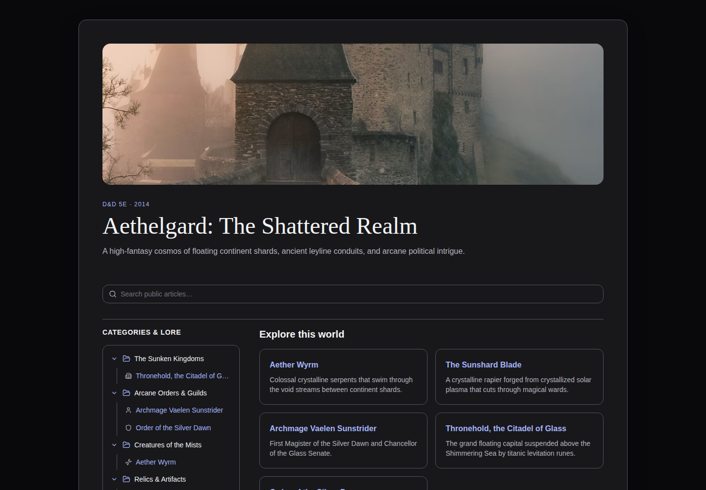
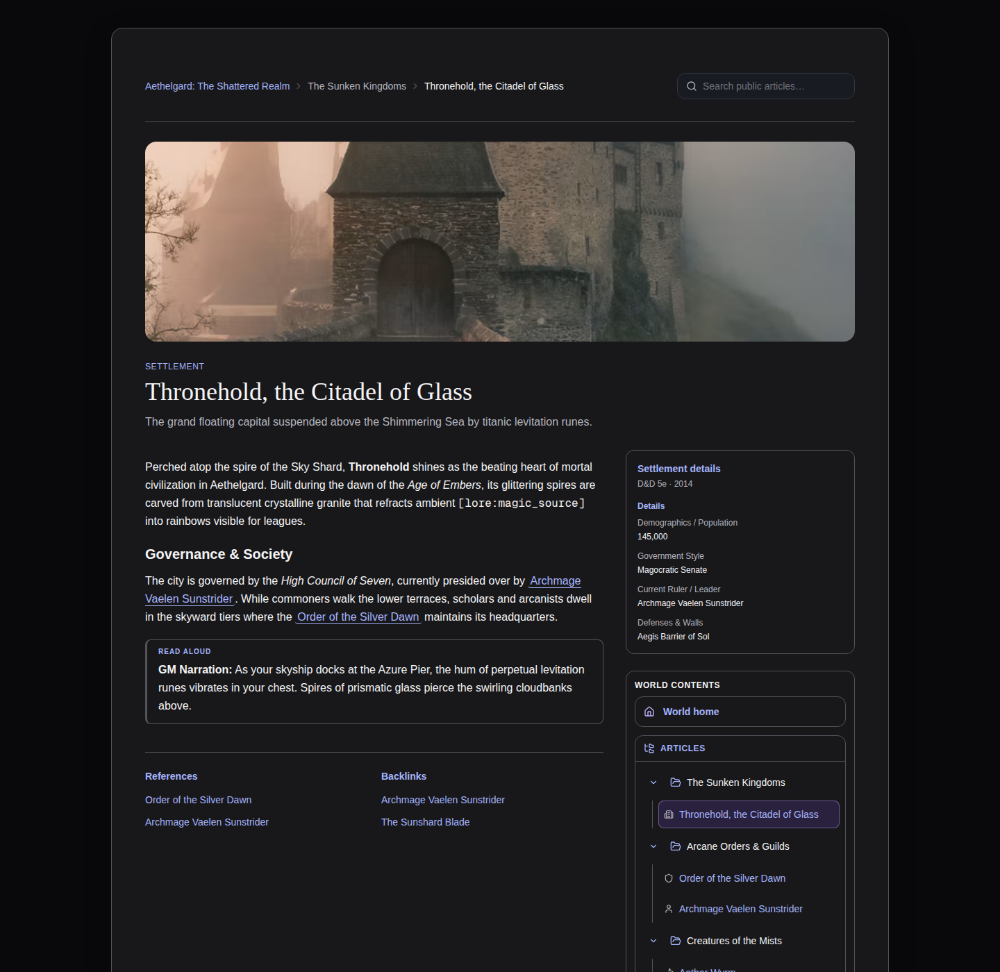

# WorldForge

A self-hosted campaign worldbuilding workspace for **D&D 5e (2014)** and
**Pathfinder 2e Remaster**. Author a wiki-style world of articles, statblocks,
maps and timelines, then share a curated, permission-controlled reader view with
your players.

WorldForge is a local-first web app: your campaign content lives in a SQLite
database and an image directory that you own and back up.

**AI disclosure:** AI tools helped create parts of this project's code and
documentation. AI output can contain errors; review and test the software for
your use, and keep backups of your campaign data. See the
[AI disclosure](docs/ai-disclosure.md).

## Screenshots





Both views come from the optional Aethelgard demo seed.

## Features

- **Block-based editor** — slash commands, drag/reorder, tables, images,
  callouts and embedded statblocks.
- **28 article templates** with edition-specific fields for characters,
  creatures, places, organizations, lore, rules content and more.
- **Structured compendium** — D&D 5e and PF2e creatures, NPCs, spells and items
  rendered in distinct edition themes.
- **Wikilinks and backlinks**, hierarchical categories, and Ctrl/Cmd+K command
  search across article bodies and metadata.
- **World appearance** — preset themes, backgrounds, accent colors and reading
  widths, with live author preview.
- **Image library** — upload, normalize to WebP, reuse across articles and
  worlds, with archive and safe deletion.
- **Revision history** — server-side snapshots, restore, and concurrent-edit
  detection.
- **GM tools** — secrets, preview-as-player, campaign sessions and notebooks.
- **Table access** — world members, per-resource audience policies and grants,
  and an access audit trail.
- **Interactive maps, timelines and variable macros** (`[prefix:key]`).
- **Public reader pages** with breadcrumbs, category navigation and scoped
  search for anonymously published content.
- **Backup and portability** — per-world export/import and archive/restore/purge.
- **FoundryVTT import** — selective, preview-first import of PF2e Item exports
  (provisional; see `docs/foundryvtt-integration.md`).

## Roadmap

- **Player-only accounts:** Add GM invitations, account claiming, a player home
  page for shared worlds, and in-app membership and sharing controls. Enforce
  read-only access and immediate revocation across pages, search and assets.
  The membership APIs and player reader exist; the complete account flow is
  [planned](docs/feature-improvements.md#player-only-account-flow-planned).
- **FoundryVTT integration:** Expand the provisional PF2e Item import toward
  export and later synchronization, after validating compatibility with real
  Foundry exports. See the [integration proposal](docs/foundryvtt-integration.md).

See the [full roadmap and feature status](docs/feature-improvements.md). Planned
work has no committed release date.

## Self-host with Docker

The supported way to run WorldForge is Docker Compose.

```bash
git clone https://github.com/emorgan33/worldforge.git
cd worldforge
cp .env.example .env        # adjust if needed; keep WORLDFORGE_ORIGIN correct
docker compose up -d --build
```

Open http://localhost:3033. The container applies database migrations on start.

Generate a one-time setup link for the first GM account, then open the printed
`/setup#token=...` URL in your browser to set an email and password. On an empty
database, this command creates the first account without loading demo content:

```bash
docker compose exec worldforge pnpm auth:setup
```

To create an account with a specific email, including when other accounts
already exist, run:

```bash
docker compose exec worldforge pnpm auth:setup -- --create you@example.com
```

Open its setup link to choose the password. New accounts can create their own
worlds after signing in. To reset an existing account's password, run
`docker compose exec worldforge pnpm auth:setup -- you@example.com` instead.

Optionally load the sample "Aethelgard" campaign **before setting up an account**.
The seed replaces existing data, so do not run it on an installation with content:

```bash
docker compose exec worldforge pnpm db:seed
```

### Persistent data

`docker-compose.yml` mounts a single named volume, `worldforge-data`, at `/data`:

- `/data/worldforge.db` — the SQLite database.
- `/data/assets` — uploaded images (`WORLDFORGE_ASSET_DIR`).

Back up the whole volume and you have the complete campaign. To run behind a
reverse proxy, set `WORLDFORGE_ORIGIN` to the public URL (including scheme and,
when non-standard, port) so same-origin writes are accepted, and terminate TLS
at the proxy.

## Configuration

Copy `.env.example` to `.env`. Variables:

| Variable | Required | Purpose |
| --- | --- | --- |
| `DATABASE_URL` | yes | SQLite path. Relative paths resolve from `prisma/`, so `file:./dev.db` → `prisma/dev.db`. |
| `WORLDFORGE_ORIGIN` | production | Public origin used for same-origin/CSRF checks. Must match the browser URL or writes return 403. |
| `WORLDFORGE_ASSET_DIR` | no | Uploaded-image directory. Defaults to `./data/assets`. |

## Local development

Requirements: **Node.js 22+** and **pnpm 10**.

```bash
pnpm install
cp .env.example .env
pnpm db:deploy
pnpm db:seed        # optional; replaces existing data
pnpm dev            # http://localhost:3001
```

Set a password with `pnpm auth:setup`, or create an account for a specific email
with `pnpm auth:setup -- --create you@example.com`, then sign in at `/login`.
See [CONTRIBUTING.md](CONTRIBUTING.md) for the full workflow, test commands and
pull-request expectations.

## Documentation

Design and feature references live in [`docs/`](docs/):

- [Feature status and roadmap](docs/feature-improvements.md)
- [Publishing and permissions](docs/publishing-and-permissions.md)
- [Article revisions](docs/article-revisions.md)
- [Editor and category manager](docs/editor-and-category-manager.md)
- [Autosave and recovery](docs/autosave-and-recovery.md)
- [Image library](docs/image-library.md)
- [World appearance](docs/world-appearance.md)
- [Campaign rules profiles](docs/rpg-systems.md)
- [World creation and switcher](docs/world-creation-and-switcher.md)
- [Backup and restore](docs/backup-restore.md)
- [FoundryVTT integration](docs/foundryvtt-integration.md)

## Tech stack

Next.js 16 (App Router, React 19, Turbopack) · TypeScript · Prisma 6 + SQLite ·
TipTap 3 · Tailwind CSS 4.

## Contributing

Contributions are welcome. Please read [CONTRIBUTING.md](CONTRIBUTING.md) and the
[Code of Conduct](CODE_OF_CONDUCT.md). To report a security issue, see
[SECURITY.md](SECURITY.md).

## License

[MIT](LICENSE).

Bundled fonts and theme textures retain their original licenses; see
[`docs/licenses/`](docs/licenses/).
