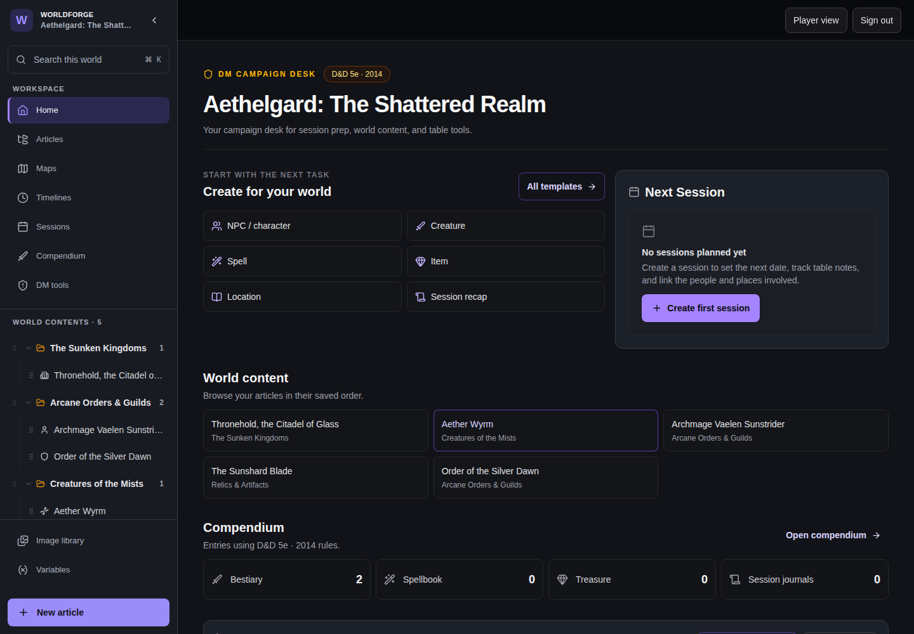
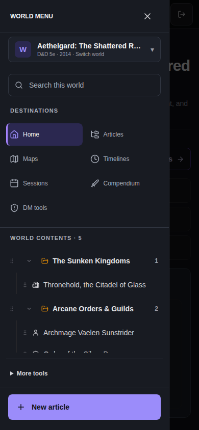

# WorldForge

A self-hosted campaign worldbuilding workspace for **D&D 5e (2014)** and
**Pathfinder 2e Remaster**. Author a wiki-style world of articles, statblocks,
maps and timelines, then share a curated, permission-controlled reader view with
your players.

WorldForge is a local-first web app: your campaign content lives in a SQLite
database and an image directory that you own and back up.

**AI disclosure:** AI tools helped create parts of this project's code and
documentation. AI output can contain errors; review and test the software for
your use, and keep backups of your campaign data. See the
[AI disclosure](docs/ai-disclosure.md).

## Screenshots

### Desktop



### Mobile



Both views come from the optional Aethelgard demo seed and show the current
Night Watch author workspace.

## Features

- **Block-based editor** — slash commands, drag/reorder, tables, images,
  callouts and embedded statblocks.
- **28 article templates** with edition-specific fields for characters,
  creatures, places, organizations, lore, rules content and more.
- **Interactive character sheets** — paper-style D&D 5e 2014 and Pathfinder 2e
  Remaster sheets with editable statistics, resources and repeatable rows;
  D&D ability modifiers calculate from scores.
- **Structured compendium** — D&D 5e and PF2e creatures, NPCs, spells and items
  rendered in distinct edition themes.
- **Wikilinks and backlinks**, hierarchical categories, and Ctrl/Cmd+K command
  search across article bodies and metadata.
- **World appearance** — preset themes, backgrounds, accent colors and reading
  widths, with live author preview.
- **Image library** — upload and normalize to WebP, reuse images within their
  owning world, hide images without breaking existing placements, and safely
  delete only assets with no persistent references. See the
  [image library guide](docs/image-library.md).
- **Curated stock art** — browse a local fantasy-art catalog, inspect source and
  rights details, preview placements, preserve provenance through world
  backups, and show credits to readers. The installed candidates are still
  pending human rights and design review; production selection remains disabled
  until those reviews are recorded. See [curated stock art](docs/stock-art.md)
  and its [review gates](docs/stock-art-review/README.md).
- **Revision history** — server-side snapshots, restore, and concurrent-edit
  detection.
- **GM tools** — secrets, preview-as-player, campaign sessions and notebooks.
- **Night watch author workspace** — a compact campaign desk for creation and
  session preparation, with world settings and campaign rules in their own
  destination. See the [workspace design and validation](docs/feature-requests/night-watch-author-workspace.md).
- **Table access** — world members, per-resource audience policies and grants,
  and an access audit trail.
- **Interactive maps** — multiple maps per world with layers, pins linked to
  articles, labels, lines, circles, rectangles, freehand drawing and a
  paint-style eraser. See [interactive maps](docs/interactive-maps.md).
- **Timelines and [variable macros](docs/variable-macros.md)** (`[prefix:key]`).
- **Public and campaign reader pages** with breadcrumbs, expandable category
  navigation, mobile browsing controls and search scoped to readable articles.
- **Responsive campaign navigation** with a collapsible desktop sidebar and a
  mobile navigation drawer. The World contents pane stays scrollable without
  displaying a scrollbar.
- **Backup and portability** — per-world export/import and archive/restore/purge.
- **FoundryVTT import** — selective, preview-first import of PF2e Item exports
  (provisional; see `docs/foundryvtt-integration.md`).
- **Player accounts and sharing** — GM-generated invitation links, player home,
  member management, and per-resource audience controls with immediate
  revocation. See [player accounts](docs/player-accounts.md).

## Roadmap

- **FoundryVTT integration:** Expand the provisional PF2e Item import toward
  export and later synchronization, after validating compatibility with real
  Foundry exports. See the [integration proposal](docs/foundryvtt-integration.md).

See the [full roadmap and feature status](docs/feature-improvements.md). Planned
work has no committed release date.

## Self-host with Docker

The supported way to run WorldForge is Docker Compose. Choose a **published
release image** (no checkout or local build) or **build from source**.

### Published release image

Images target [`emorgan33/worldforge`](https://hub.docker.com/r/emorgan33/worldforge)
on Docker Hub, initially for **linux/amd64**. Use a version listed in the
[GitHub release notes](https://github.com/emorgan33/worldforge/releases) after
its **Release Docker image** workflow succeeds. Older releases may not have
images; packaging support alone does not mean the first image is published.

Replace both occurrences of `VERSION` below with that published version
(without the leading `v`):

```bash
mkdir worldforge && cd worldforge
curl -fsSLo compose.yml https://raw.githubusercontent.com/emorgan33/worldforge/vVERSION/docker-compose.release.yml
cat > .env <<'EOF'
WORLDFORGE_IMAGE=emorgan33/worldforge:VERSION
WORLDFORGE_ORIGIN=http://localhost:3033
WORLDFORGE_TRUSTED_PROXY=0
EOF
docker compose pull
docker compose up -d --wait
```

Pin a version or its release-noted digest (`emorgan33/worldforge@sha256:...`)
for predictable upgrades. `latest` follows the current stable release, not
prereleases. See [releases and upgrades](#releases-and-upgrades) before updating.

### Build from source

```bash
git clone https://github.com/emorgan33/worldforge.git
cd worldforge
cp .env.example .env        # adjust if needed; keep WORLDFORGE_ORIGIN correct
docker compose up -d --build
```

### First account

For either path, open http://localhost:3033. The container applies database migrations on start.
Set `WORLDFORGE_HOST_PORT` to change the host-side port and set
`WORLDFORGE_ORIGIN` to the URL used in the browser. See the
[deployment configuration guide](docs/deployment-configuration.md) and
[backup and restore guide](docs/backup-restore.md) for operational details.

Generate a one-time setup link for the first GM account, then open the printed
`/setup#token=...` URL in your browser to set an email and password. On an empty
database, this command creates the first account without loading demo content:

```bash
docker compose exec worldforge pnpm auth:setup
```

To create an account with a specific email, including when other accounts
already exist, run:

```bash
docker compose exec worldforge pnpm auth:setup -- --create you@example.com
```

Open its setup link to choose the password. New accounts can create their own
worlds after signing in. To reset an existing account's password, run
`docker compose exec worldforge pnpm auth:setup -- you@example.com` instead.

Optionally load the sample "Aethelgard" campaign **before setting up an account**.
The seed replaces existing data, so do not run it on an installation with content:

```bash
docker compose exec worldforge pnpm db:seed
```

### Persistent data

Both Compose files mount a single named volume, `worldforge-data`, at `/data`:

- `/data/worldforge.db` — the SQLite database.
- `/data/assets` — uploaded images (`WORLDFORGE_ASSET_DIR`).

Back up the whole volume and you have the complete campaign. To run behind a
reverse proxy, set `WORLDFORGE_ORIGIN` to the public URL (including scheme and,
when non-standard, port) so same-origin writes are accepted, and terminate TLS
at the proxy.

Never remove the data volume with `docker compose down --volumes`. When
switching deployment methods or directories, preserve the Compose project name,
existing volume, and any reverse-proxy network overrides. For public HTTPS,
set `WORLDFORGE_TRUSTED_PROXY=1` and configure a private proxy as described in the
[deployment guide](docs/deployment-configuration.md).

## Releases and upgrades

- [GitHub releases](https://github.com/emorgan33/worldforge/releases) contain
  release notes and, after successful publication, the Docker image tag/digest.
  Repository [release records](docs/releases/) describe historical changes;
  they are not evidence that a Docker image exists for every old version.
- Publishing a GitHub release triggers image packaging for its exact tag.
  A push to `main` or a tag push by itself does **not** publish an image.
  Versions use `X.Y.Z` image tags for `vX.Y.Z` Git tags; full-commit tags use
  `sha-<commit>`. Prereleases do not advance `latest`.
- Before every upgrade, stop the service and take a verified **database plus
  assets** backup. For a published-image install, change `WORLDFORGE_IMAGE` in
  `.env`, then run `docker compose pull` and `docker compose up -d --wait`.
  For a source-build install, select the intended source revision and rebuild
  with `docker compose up -d --build`.
- Check startup logs, sign-in, worlds, and uploaded images after upgrading.
  Rolling back may require restoring the matching pre-upgrade backup, not just
  selecting an older image, because startup applies database migrations.

Image CI scans for package advisories before publishing and blocks fixable
HIGH/CRITICAL findings. Unfixed findings remain visible in the full report;
a green build is **not** a vulnerability-free guarantee. See
[container security](docs/container-security.md) for policy and scan commands.

See the [wiki upgrade guide](https://github.com/emorgan33/worldforge/wiki/Upgrading-and-Releases)
for operator steps and [release publishing](docs/releases/README.md) for the
maintainer checklist.

## Configuration

For source builds, copy `.env.example` to `.env`; published-image installs use
the `.env` shown above. Variables:

| Variable | Required | Purpose |
| --- | --- | --- |
| `WORLDFORGE_IMAGE` | published-image Compose | Versioned `emorgan33/worldforge` image or digest pin; no default. |
| `DATABASE_URL` | yes | SQLite path. Relative paths resolve from `prisma/`, so `file:./dev.db` → `prisma/dev.db`. |
| `WORLDFORGE_ORIGIN` | production | Public origin used for same-origin/CSRF checks. Must match the browser URL or writes return 403. |
| `WORLDFORGE_TRUSTED_PROXY` | public HTTPS | Set to `1` only behind a private proxy that overwrites `X-WorldForge-Client-IP`. |
| `WORLDFORGE_ASSET_DIR` | no | Uploaded-image directory. Defaults to `./data/assets`. |

## Local development

Requirements: **Node.js 22+** and **pnpm 10**.

```bash
pnpm install
cp .env.example .env
pnpm db:deploy
pnpm db:seed        # optional; replaces existing data
pnpm dev            # http://localhost:3001
```

Set a password with `pnpm auth:setup`, or create an account for a specific email
with `pnpm auth:setup -- --create you@example.com`, then sign in at `/login`.
See [CONTRIBUTING.md](CONTRIBUTING.md) for the full workflow, test commands and
pull-request expectations.

### Testing

Run the full suite with `pnpm test` against a temporary SQLite database and
temporary asset directory, with the dev server using the same paths. The setup
in [CONTRIBUTING.md](CONTRIBUTING.md) includes the environment variables needed
to run every integration test; do not run tests against your configured data.

## Documentation

The [WorldForge wiki](https://github.com/emorgan33/worldforge/wiki) is the
task-oriented guide for users and operators. Its reviewable source lives in
[`wiki/`](wiki/). The [`docs/`](docs/) directory remains the canonical home for
implementation contracts, design decisions, release notes, validation reports,
and historical records:

- [WorldForge v0.4.3 security-update notes](docs/releases/v0.4.3.md) (check GitHub releases for publication)
- [Release publishing and image versions](docs/releases/README.md)
- [Deployment configuration](docs/deployment-configuration.md)
- [Feature status and roadmap](docs/feature-improvements.md)
- [Publishing and permissions](docs/publishing-and-permissions.md)
- [Article revisions](docs/article-revisions.md)
- [Editor and category manager](docs/editor-and-category-manager.md)
- [Autosave and recovery](docs/autosave-and-recovery.md)
- [Image library](docs/image-library.md)
- [Curated stock art](docs/stock-art.md) · [Stock-art review gates](docs/stock-art-review/README.md)
- [World appearance](docs/world-appearance.md)
- [Campaign rules profiles](docs/rpg-systems.md)
- [Interactive character sheets](docs/character-sheets.md)
- [Interactive maps](docs/interactive-maps.md)
- [World creation and switcher](docs/world-creation-and-switcher.md)
- [Reader navigation and discovery](docs/reader-navigation-and-discovery.md)
- [Night watch author workspace](docs/feature-requests/night-watch-author-workspace.md) · [Validation report](docs/night-watch-validation-2026-10-23.md)
- [Backup and restore](docs/backup-restore.md)
- [Installation administration](docs/installation-administration.md)
- [FoundryVTT integration](docs/foundryvtt-integration.md)

## Tech stack

Next.js 16 (App Router, React 19; Webpack production build) · TypeScript · Prisma 6 + SQLite ·
TipTap 3 · Tailwind CSS 4.

## Contributing

Contributions are welcome. Please read [CONTRIBUTING.md](CONTRIBUTING.md) and the
[Code of Conduct](CODE_OF_CONDUCT.md). To report a security issue, see
[SECURITY.md](SECURITY.md).

## License

[MIT](LICENSE).

Bundled fonts and theme textures retain their original licenses; see
[`docs/licenses/`](docs/licenses/).
