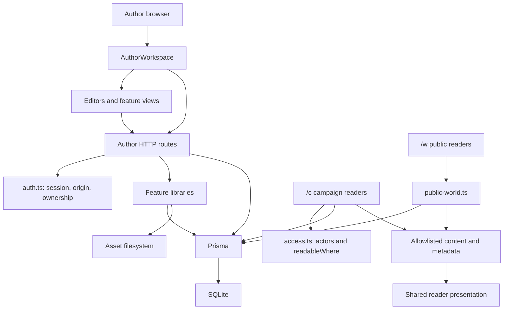
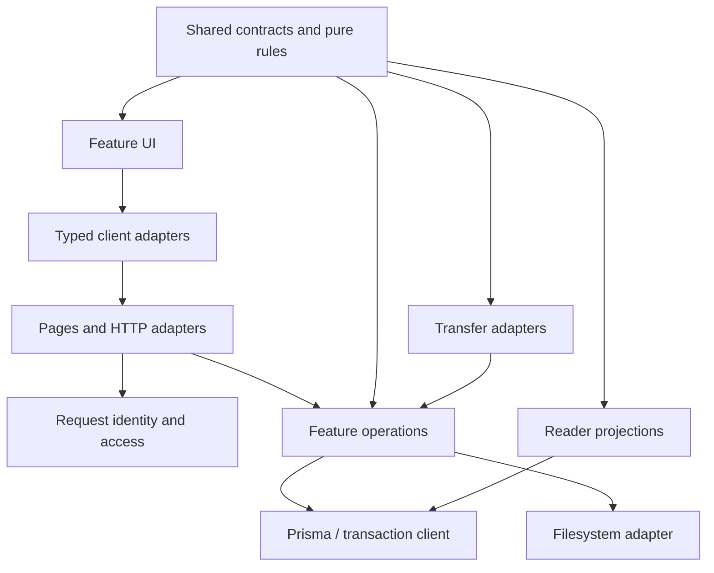

# WorldForge Repository Audit and Refactoring Plan

Audit basis: repository revision `1be1903`.

Status: audit complete; R01, R01a, R02, R03, R03a, R04, R04a, R05, R06, R07, R08, R09, R10, R13, R14 and R16 are complete. This roadmap does not itself authorize changes; implementation was authorized by the user's explicit request. Validation results are recorded in the task entries.

## 1. Executive summary

WorldForge has a suitable foundation for a self-hosted application, but several important guarantees are implemented inconsistently across features. **Incremental refactoring is justified; replacing the stack or rewriting the application is not.**

The highest-priority finding is a destructive cleanup defect: an owner-scoped endpoint scans the shared asset directory and can delete image files belonging to other worlds. Other significant findings include ineffective article conflict detection, imports that produce editor-incompatible visibility values, unsafe variable HTML rendering, and tests that can pass without exercising their intended behavior.

The most valuable architectural improvement is to concentrate complete operations—saving an article, restoring a revision, deleting an asset, importing a world, changing access—behind cohesive, tested modules. File reorganization should follow those improvements.

The audit made no repository changes. Existing screenshot-related changes were left untouched during the audit and remain untouched by R01 implementation.

## 2. Repository architecture map

### Inspection coverage and limits

The audited source revision was `1be1903`.

The initial inventory contained **452 tracked files** and approximately **37,000 lines of nonbinary text**, excluding the dependency lockfile.

| Area | Coverage |
|---|---|
| Application dependencies | Statically mapped 167 TypeScript files and 527 local import relationships |
| API | Reviewed all 52 route-handler files |
| Domain and persistence | Reviewed all 48 library files, including access control, storage, import/export, profiles and recovery |
| UI | Combined review covered all 57 component files, shared types and application CSS |
| Tests | Reviewed all 58 test/helper/diagnostic files: 55 test suites and three supporting files |
| Database and operations | Reviewed schema, migrations, seed, backfill, scripts, Docker, Compose, CI and configuration |
| Documentation | Reviewed tracked human-authored documentation and relevant catalog/evidence data |
| Dependencies | Reviewed manifest, lockfile importer and runtime packaging; did not assess every transitive package |

Excluded were dependency implementations, generated/build output, binary images/fonts, vendored license text and generated screenshot logs. Production secrets, runtime databases and external services were not accessed. Binary artwork was not visually or legally reviewed.

This provides broad source-level coverage. It does **not** establish runtime performance, browser behavior, production authentication reliability or absence of dependency vulnerabilities.

Line references below describe the audited revision and may move as implementation proceeds.

### Purpose and technology

WorldForge is a self-hosted campaign worldbuilding application with:

- Articles, rich-text editing, categories, references and revision history.
- Specialized D&D 5e 2014 and Pathfinder 2e Remaster sheets and statblocks.
- GM maps, timelines, variables, secrets and session preparation.
- Public publication and authenticated player sharing.
- Local image storage, stock-art provenance and per-world portability.
- A provisional, selective Foundry Item importer.

The application uses Next.js 16.4.1, React 19.3, TypeScript, Prisma 6.19.3, SQLite, TipTap 3, Tailwind CSS 4 and Sharp. Node 22 and pnpm 10.14.0 form the documented deployment baseline.

### Repository inventory

| Path | Responsibility |
|---|---|
| `src/app/` | App Router pages, layouts and HTTP entry points |
| `src/app/api/` | Author mutations, authentication, sharing, assets, search and portability |
| `src/app/w/` | Anonymous public readers |
| `src/app/c/` | Authenticated campaign readers and GM preview |
| `src/components/AuthorWorkspace.tsx` | World selection, history, loading, feature coordination and mutations |
| `src/components/article/`, `editor/` | Article editing, rendering, character sheets and TipTap extensions |
| `src/components/assets/` | Uploaded-image library, stock browser, selection and placement |
| `src/components/campaign/` | Sessions, membership, audience controls and GM tools |
| `src/components/map/` | Cartography editor, tools, canvas and selection |
| `src/components/public/` | Shared reader navigation and allowlisted content presentation |
| `src/components/worlds/` | Creation, switching, lifecycle controls and navigation guards |
| `src/lib/` | Domain definitions, authorization, persistence operations, projections and recovery |
| `src/lib/foundry/` | Bounded parsing, PF2e mapping, preview, idempotent import and outcomes |
| `src/types/` | Shared application-facing types |
| `prisma/` | SQLite schema, additive migration history, destructive demo seed and legacy backfill |
| `resources/stock-art/` | Runtime catalog, provenance evidence and image derivatives |
| `scripts/` | Account setup, startup, local service and stock maintenance |
| `tests/` | Node test-runner suites: pure logic, server rendering, services and HTTP integration |
| `.github/workflows/` | Lint/build, unit, service, dev-server HTTP and production-auth jobs |
| `docs/` | Feature contracts, operational instructions, historical plans and verification records |
| `public/themes/` | Bundled theme fonts and textures |
| `skills/` | An empty Python stub and small tooling declaration; no application dependency found |

### Current architecture

The following relationships are directly supported by imports and calls:

The architecture combines server-rendered reader pages, a substantial client-side author application, route handlers containing transport and business logic, feature libraries with varying operation completeness, and separate publication and player-audience systems.

The separation between public and author data is deliberate and valuable. The inconsistency lies primarily in how operations enforce that separation and maintain related state.

### Request and data lifecycles

**Author requests:** session resolution → route-derived ownership checks → handler validation → Prisma/file operations → private, noncached response.

**Public reads:** public world and published/public article filtering → document and metadata projection → shared reader rendering. GM subtrees and inaccessible inline references are removed before presentation.

**Campaign reads:** actor/preview resolution → membership and audience filtering → readable article, asset and statblock projections → reader rendering. Category paths are filtered to readable articles.

**World transfer:** collect related rows → read embedded image bytes → versioned JSON export; import remaps identifiers, creates records and files, and compensates for failures.

**Maintenance:** asset cleanup jobs are durable database rows, drained by lifecycle requests. No external queue, scheduler or worker service is defined.

### Coupling and dependency findings

The import analysis found two cycles:

- `rpg.ts` ↔ `pf2-statblocks.ts`.
- `ArticleEditorForm.tsx` ↔ `article-drafts.ts`.

Both contain type-only relationships. **No runtime-cycle defect was established.** The second still demonstrates an undesirable dependency direction: domain recovery code imports its save contract from a UI file. See [article-drafts.ts:1](src/lib/article-drafts.ts#L1).

The more consequential coupling is behavioral:

- [AuthorWorkspace.tsx:29](src/components/AuthorWorkspace.tsx#L29) coordinates navigation, history, loading, guards and many unrelated mutations.
- [auth.ts:62](src/lib/auth.ts#L62) infers authorization requirements from URL segments and body shape.
- Article save, restore and clone implement different subsets of the article lifecycle.
- Legacy transfer logic exists in route handlers alongside the richer [world-export.ts](src/lib/world-export.ts).
- Campaign projections duplicate substantial orchestration inside page components.

These are reasons to establish stronger module interfaces, rather than simply split large files.

## 3. Technical debt register

“Confirmed” means supported by source inspection. Runtime reproduction is identified separately.

| ID | Priority | Finding | Evidence and impact |
|---|---|---|---|
| F01 | **P0** | Cleanup can delete other worlds' files | [cleanup/route.ts:69](src/app/api/worlds/[id]/cleanup/route.ts#L69) scans the shared directory, but compares against only the selected world's IDs collected at line 40. Any other world's image can be classified as orphaned and unlinked. |
| F02 | P1 | Three HTTP suites mutate the configured database even when their tests skip | Unconditional hooks in [assets-api.test.tsx:15](tests/assets-api.test.tsx#L15), [world-backup-restore.test.tsx:21](tests/world-backup-restore.test.tsx#L21), and [world-export-import-api.test.tsx:16](tests/world-export-import-api.test.tsx#L16). |
| F03 | P1 | Asset API tests conceal authentication failures | [assets-api.test.tsx:35](tests/assets-api.test.tsx#L35) creates an invalid session and sends the wrong cookie. Tests return successfully on `401`; setup also fetches an external image. |
| F04 | P1 | Three asset detail endpoints reject valid UUID parameters | Usage, dedicated archive and permanent-delete handlers call URL parser `imageAssetId(id)` on a bare UUID. See [usage/route.ts:28](src/app/api/assets/[id]/usage/route.ts#L28), [assets/[id]/route.ts:15](src/app/api/assets/[id]/route.ts#L15), and [permanent/route.ts:31](src/app/api/assets/[id]/permanent/route.ts#L31). |
| F05 | P1 | Asset lifetime checks omit persistent references | [asset-references.ts:64](src/lib/asset-references.ts#L64) and line 110 omit maps, layers, timeline covers and revision images/content. Files are also deleted before database rows in the permanent-delete path. |
| F06 | P1 | Article conflict detection is absent | [articles/[id]/route.ts:69](src/app/api/articles/[id]/route.ts#L69) reads the existing article before the transaction; update matches only `id` and increments a previously read version. The editor sends no expected version. |
| F07 | P1 | Revision restore bypasses lifecycle invariants | [revisions/route.ts:104](src/app/api/articles/[id]/revisions/route.ts#L104) creates the recovery snapshot outside the restore transaction; line 146 rewinds the version. Mentions and word count are not rebuilt. |
| F08 | P1 | Imported articles can fail when opened for editing | [world-export.ts:596](src/lib/world-export.ts#L596) and legacy import persist `visibility: "INHERITED"`. [publication.ts:6](src/lib/publication.ts#L6) rejects that value; the editor calls the normalizer during render. |
| F09 | P1 | Imported variable HTML reaches a live author DOM sink | [variable-parser.ts:20](src/lib/variable-parser.ts#L20) interpolates unescaped values; [VariableManager.tsx:94](src/components/variables/VariableManager.tsx#L94) uses `dangerouslySetInnerHTML`. Import retains those values. |
| F10 | P1 | Relationship metadata lacks shared reference semantics | New participant and article-reference fields are plain strings in [templates.ts:371](src/lib/templates.ts#L371). Reader projection copies known strings without reference authorization; import remaps only selected reference patterns. |
| F11 | P1 | Portable backup fidelity and capacity are incomplete | [world-export.ts:212](src/lib/world-export.ts#L212) exports timeline events without eras. Map element chronology lacks an explicit portable ordering contract. Export has no corresponding total-size bound, while import rejects bundles over 60 MiB. |
| F12 | P1 | Lost import responses can create duplicate worlds on retry | [WorldManagement.tsx:196](src/components/worlds/WorldManagement.tsx#L196) remembers the imported world only after receiving the POST response. The import route has no durable request identity. |
| F13 | P1 | Regression gates omit important production and concurrency behavior | [CI:86](.github/workflows/ci.yml#L86) omits `WORLD_CREATION_TEST_DATABASE_URL`; [world-creation.test.tsx:5](tests/world-creation.test.tsx#L5) therefore skips. CI starts only a development server. |
| F14 | P1 | Authorization has duplicated, inconsistent implementations | `auth.ts` and `access.ts` separately define session lookup, `AccessError`, origin checks and resource-world resolution. Errors from one class are not recognized by the other wrapper. |
| F15 | P1 | Map and variable pending-write state permits races | [InteractiveMap.tsx:622](src/components/map/InteractiveMap.tsx#L622) clears shared draft state after awaiting a save, potentially clearing a newer stroke. Single busy flags/IDs can clear while another write remains pending. |
| F16 | P2 | Access changes, grants and audit events are not consistently atomic | [membership.ts:33](src/lib/membership.ts#L33) performs revocation across several separate writes. Audience routes commit policy changes before separately writing audit events. Session “next” changes also use separate statements. |
| F17 | P2 | Failed variable writes can be presented as successful | [AuthorWorkspace.tsx:641](src/components/AuthorWorkspace.tsx#L641) ignores mutation HTTP status and catches failures; the child then clears its edited value. |
| F18 | P2 | Search and reader work grows with world size | [search/route.ts:14](src/app/api/search/route.ts#L14) loads all matching rows before ranking/pagination; [public-world.ts:94](src/lib/public-world.ts#L94) reparses all public articles for backlinks. |
| F19 | P2 | Map validation differs between create, update and import | [maps/route.ts:286](src/app/api/maps/route.ts#L286) accepts a changed kind without revalidating existing geometry unless geometry is supplied. Coordinate clamping results are discarded by geometry validation. |
| F20 | P2 | CSS scoping does not enforce its advertised scope | [world-appearance.ts:107](src/lib/world-appearance.ts#L107) uses regex rewriting with exceptions that leave nested rules or mixed selector lists unscoped. Existing tests explicitly preserve some unscoped output. |
| F21 | P2 | Documentation and UI overstate guarantees | Revision conflict detection, image caching, cleanup completeness and several verification claims differ from current code. GM controls say “Reveal to Players,” although secret records remain owner-only. |

Additional confirmed inconsistencies belong with the related tasks:

- Archived images remain in public page projections, but anonymous byte access rejects archived assets at [file/route.ts:25](src/app/api/assets/[id]/file/route.ts#L25), contradicting the documented “hide preserves references” behavior.
- Public asset authorization inspects only ten candidate articles at [public-world.ts:77](src/lib/public-world.ts#L77). Ten prose/GM-note matches can precede a legitimate visible image reference.
- Draft recovery omits `canonState` at [ArticleEditorForm.tsx:207](src/components/article/ArticleEditorForm.tsx#L207).
- Asset-detail navigation can unmount a dirty form without consulting its guard.
- `EntityRelationshipPicker` offers a statblock filter but fetches only articles.
- `PlayerSidebar.tsx` and several policy helpers have no application callers.

## 4. Security, reliability and performance findings

### Confirmed security-relevant paths

**Cross-world file deletion is the urgent issue.** The cleanup caller needs authorization for its selected world, but file deletion extends beyond that world. No production execution was performed.

**Variable rendering has a statically traceable injection path:** imported variable values → persisted collection → default macro testbench → raw HTML insertion. This requires supplying or importing content that an author later opens. No browser exploit was executed, and no unauthenticated write path was established.

**Relationship metadata can carry inaccessible reference IDs into reader output.** This does not bypass the referenced resource's API authorization. It shows that metadata references lack the policy-aware projection applied to inline links and embedded blocks.

Existing safeguards worth preserving include hashed random session/setup/invitation tokens, salted scrypt passwords, same-origin mutation checks, upload byte and pixel bounds, allowlisted reader documents, independent campaign embed grants and noncached protected responses.

No confirmed dependency CVEs are reported: external advisory services were deliberately not consulted.

### Confirmed reliability defects

The strongest evidence concerns cleanup ownership, invalid asset-ID validation, missing save preconditions, incompatible imported visibility and restore-derived-state drift.

Other source-confirmed failure paths require timing or fault injection to reproduce:

- Concurrent saves can overwrite changes without preserving the overwritten intermediate state.
- A completed map write can clear a newer drawing draft.
- Partial membership revocation can leave grants available for later reactivation.
- A committed import followed by a lost response can be repeated.
- File removal followed by database failure can leave a live row pointing to missing bytes.

These should become deterministic regression tests before architectural extraction.

### Performance risks requiring measurement

The source supports identifying expensive patterns, but not assigning measured latency or memory impact:

- Every world load fetches seven datasets, including full article rows.
- Article lists silently stop at 2,000 rows.
- Saves often refetch both the article list and detail.
- Search pagination happens after loading and sorting all matches.
- Public backlinks reparse a world's published content.
- Reader queries load more statblocks than a page ultimately renders.
- JSON/base64 export buffers the complete result despite batching file reads.

Measure these before choosing FTS, additional caching or a different transfer format. Preserve immediate publication and membership revocation when introducing caches.

### Production uncertainty

[CONTRIBUTING.md:64](CONTRIBUTING.md#L64) records production-cookie unreliability, while historical documents report successful production checks. This audit did not reproduce either result.

Treat that discrepancy as a **release-validation gap**, not a proven current framework defect.

## 5. Recommended target architecture

Retain a single deployable Next.js application, SQLite, Prisma, TipTap and local asset storage.

Organize around cohesive modules with small public interfaces:

| Module | Owns |
|---|---|
| Identity and access | Session resolution, actor identity, ownership, readable-resource policy and typed access errors |
| Articles | Save preconditions, publication normalization, revisions, mention updates and derived values |
| Article contracts | Shared DTOs and field/reference definitions used by editor, readers and transfer |
| Assets | Acquisition, reference discovery, placement validation, archive semantics and durable deletion |
| Readers | Separate public/campaign queries producing a common safe presentation model |
| World transfer | Version adapters, validation, ID remapping, import execution and recovery |
| Cartography | Geometry/style contracts, drawing identity, pending writes and chronological replay |
| Campaign operations | Membership, audience changes, sessions and transactional audit |
| Workspace coordination | Selection/history transitions, snapshot loading and feature controllers |

These can emerge under the existing `src/lib/` and `src/components/` structure. A repository-wide move is unnecessary.

Recommended dependency rules:

1. Shared contracts must not import UI modules.
2. Client code must not import server persistence or session modules.
3. Routes translate HTTP into validated operations and translate typed outcomes back into responses.
4. A complete mutation owns its transaction, derived state and audit requirements.
5. Reader projections enforce access before constructing presentation data.
6. Transfer adapters use the same field/reference definitions as normal operations.
7. Introduce an adapter only where behavior actually varies or fault injection materially improves testing.

Do not add a generic repository layer around every Prisma call, a global state framework, an event bus, microservices or a new database without demonstrated need.

Keep these behaviors unchanged:

- Separate public publication and campaign audience rules.
- Player category paths containing only readable articles.
- Complete mounted-world retention during failed navigation.
- Account/world draft isolation and legacy recovery.
- Separate D&D/PF2e mechanics and preservation of unknown sheet extensions.
- Percentage map geometry, chronological erasing and unlayered visibility.
- Private world imports and inactive imported memberships/grants.
- Pending stock-review production gating.
- Foundry's exact-version, selective, non-overwriting MVP.

Foundry provenance omission is explicitly documented at [foundryvtt-integration.md:9](docs/foundryvtt-integration.md#L9). Preserving it in backups would be a separate design decision, not a prerequisite for this refactoring.

## 6. Prioritized refactoring roadmap

Effort is relative: **Small** is a bounded change; **Medium** spans several related files; **Large** requires staged implementation and integration validation. These are planning estimates, not delivery commitments.

| Task | Priority | Risk | Effort | Dependencies | Status |
|---|---|---|---|---|---|
| R01 Trustworthy test baseline | P1 | Low | Medium | None | **Complete** |
| R01a Verify isolation sentinel file contents | P2 | Low | Small | R01 | **Complete** |
| R02 Contain unsafe cleanup | **P0** | Low | Small | Minimum fixture work from R01 | **Complete** |
| R03 Establish asset lifetime operations | P1 | High | Large | R01, R01a, R02 | **Complete** |
| R03a Repair public image reference authorization | P2 | Medium | Small | R03; before R04 | **Complete** |
| R04 Repair asset parameter validation | P1 | Low | Small | R03 before enabling permanent deletion | **Complete** |
| R04a Correct R04 reporting and strengthen regressions | P3 | Low | Small | R04; before R05 | **Complete** |
| R05 Make variable rendering and writes safe | P1 | Medium | Medium | R01 | **Complete** |
| R06 Establish article save preconditions | P1 | Medium | Medium | R01 | **Complete** |
| R07 Unify revision restore and clone lifecycles | P1 | High | Medium | R06 | **Complete** |
| R08 Repair imported publication compatibility | P1 | Low | Small | R01 | **Complete** |
| R09 Define metadata reference contracts | P1 | High | Medium | R08 | **Complete** |
| R10 Extract transfer format adapters | P2 | Medium | Medium | R08, R09 | Complete |
| R11 Close backup fidelity and capacity gaps | P1 | High | Large | R10 | **Complete** |
| R12 Make world import retryable | P1 | High | Large | R10 | **Complete** |
| R13 Consolidate identity and authorization | P1 | High | Large | R01, production baseline | **Complete** |
| R14 Make access/session operations atomic | P1 | High | Medium | R13 | **Complete** |
| R15 Establish cartography lifecycle contracts | P1 | Medium | Medium | R01 | **Complete** |
| R16 Extract workspace feature controllers | P2 | High | Large | R05–R07, R13, R15 | Complete |
| R17 Bound search and reader work | P2 | Medium | Medium | R09, R13 | Complete |
| R18 Clarify configuration and operations | P2 | Medium | Medium | R01 | **Complete** |
| R19 Enforce CSS presentation scope | P2 | Medium | Medium | R01 | Not started |
| R20 Align documented and product guarantees | P2 | Low | Small | Alongside owning tasks | Not started |
| R21 Remove verified obsolete paths | P3 | Low | Small | R13, R16 | Not started |

### R01 — Establish a trustworthy, isolated regression baseline

**Problem/files/evidence:** F02, F03 and F13; the three unconditional setup suites, `tests/auth-fixture.ts`, CI, test commands and `CONTRIBUTING.md`.

**Changes and benefit:** Create a shared isolation requirement for database-backed tests; gate hooks before any write; use the real authentication fixture; generate local image pixels; fail on unexpected authentication responses; replace no-op assertions. Propagate the dedicated world-creation database variable. Separate pure, service and HTTP test commands clearly.

**Implementation status (2026-10-23):** Implemented in `tests/auth-fixture.ts`, the database-backed HTTP suites, `tests/assets-api.test.tsx`, `tests/world-backup-restore.test.tsx`, `tests/world-export-import-api.test.tsx`, `tests/world-export-roundtrip.test.tsx`, `tests/world-creation.test.tsx`, `tests/test-isolation.test.ts`, `tests/production-auth-smoke.test.ts`, `scripts/run-tests.mjs`, `package.json`, `.github/workflows/ci.yml`, and `CONTRIBUTING.md`. Every database-backed HTTP suite checks isolation before fixture writes; account setup tests do so without relying on `authorFetch`. Teardown only uses successfully-created IDs, including when setup fails. The rejected-configuration regression spawns the three formerly unsafe suites and the direct-auth suite, checks all SQLite table counts and asset-directory contents, and confirms unrelated sentinel user/world rows survive. It also confirms the three origin-unset suites skip without changing storage. Asset API tests use the shared hashed-session fixture and local WebP bytes; unexpected `401` responses fail assertions, and the placeholder search test was removed. CI now runs distinct unit, service, dev-server HTTP and production-auth jobs. The service job supplies the dedicated world-creation database variable. The production smoke signs in and verifies the issued cookie against session and author API endpoints. The world-management service test now keeps its SQLite file under its temporary asset directory.

The asset API tests now codify the `404` response for a collection request without an owned `worldId`; `withAuthor` deliberately conceals missing or unauthorized worlds before the handler runs. Usage, archive and permanent-delete routes validate path IDs with `isAssetId`, which accepts the bare UUID route parameter while preserving their existing owner checks.

**Validation results:** With `DATABASE_URL`, `WORLD_CREATION_TEST_DATABASE_URL`, `WORLDFORGE_ASSET_DIR`, the dev server and the test process all pointed at isolated paths under this host's `/tmp/user/1000`, `pnpm test` passed **220 tests, failed 0, skipped 1**. The sole skip was the production-auth smoke, run separately against the production server and a second temporary database; it passed **1/1**. The sentinel isolation regression passed. `pnpm build` and `pnpm exec tsc --noEmit --incremental false` passed; `pnpm lint` passed with zero errors and six existing warnings. `git diff --check` and package JSON parsing passed. The dedicated world-creation service test ran as part of the full suite.

**Validation and acceptance:** Confirmed locally: the three repaired suites skip with no database or asset changes when the origin is unset; rejected isolation configuration makes no writes or deletions and preserves sentinel records; the asset fixture makes no external request; intended asset API assertions use authenticated sessions; the full suite runs the world-creation concurrency test; and the isolated production authentication smoke passes.

**Rollback:** Revert test/CI commits independently. Keep fixtures disposable; application behavior is unaffected.

### R01a — Verify isolation sentinel file contents

**Problem/files/evidence:** Follow-up review of R01 found that `tests/test-isolation.test.ts` snapshots asset-directory filenames with `readdirSync()`, but creates no asset-file sentinel and does not compare file contents. It can detect added or removed filenames; an overwrite retaining the same filename can escape detection. R01 remains complete; this is additional regression coverage.

**Schedule:** Implement alongside R02's integration-test work in a separate test-only commit, before R03 begins. Do not delay R02's P0 cleanup containment for this follow-up. **Complete.**

**Tasks:**

1. Create a UUID-named `.webp` sentinel with known local bytes in the dedicated temporary asset directory. Record its original bytes and include its filename in the existing directory snapshot. Register cleanup for the created file without touching other assets.
2. After each rejected-configuration subprocess and each origin-unset subprocess, retain the existing database and filename assertions and read the sentinel back to assert exact byte equality. A missing file or an overwrite with the same filename must fail the check.
3. Run the focused isolation regression against dedicated temporary SQLite and asset paths, then include it in the full isolated suite at the R02 integration milestone. Retain the existing database sentinel checks and origin-unset skips.

**Validation and acceptance:** Every subprocess leaves the sentinel filename and bytes unchanged. Confirm with a controlled temporary overwrite that changing bytes while retaining the filename fails the assertion. The focused regression passes with the unmodified suites, uses no external image request, and accesses only isolated storage. Run the focused check with `node --import tsx --test --test-concurrency=1 tests/test-isolation.test.ts` after configuring and migrating the temporary database as documented in `CONTRIBUTING.md`.

**Rollback:** Revert this test-only commit independently; preserve R01's existing isolation guards and regression checks.

**Validation:** Focused isolation regression and the full isolated suite passed against the dedicated temporary database and asset directory. A controlled same-filename overwrite was detected by the byte assertion; rejected-configuration and origin-unset subprocesses preserved the sentinel.

### R02 — Contain the destructive cleanup endpoint

**Problem/files/evidence:** F01; `src/app/api/worlds/[id]/cleanup/route.ts`.

**Changes and benefit:** Removed all physical and metadata deletion from this legacy endpoint. Shared-directory files cannot be safely attributed to a world, and the current reference collector does not cover every persistent reference. The route remains available and returns an empty successful cleanup result; archived-world purge continues through durable cleanup jobs.

**Validation and acceptance:** An isolated HTTP regression with two owners, multiple worlds and an unregistered staged file confirms cleanup leaves all asset rows and file bytes unchanged. Anonymous requests return 401 and another owner's request returns 404 under the route's privacy contract. Focused regression passed. The full isolated suite passed: 221 passed, one production-auth smoke skipped by its separate production-server origin gate, zero failed.

**Rollback:** Do not restore the unsafe sweep. Retain the containment while later cleanup work is reverted.

### R03 — Concentrate asset reference and deletion rules

**Problem/files/evidence:** F05 and the archive/public-byte mismatch; `asset-references.ts`, `asset-validation.ts`, `asset-storage.ts`, `world-management.ts`, cleanup and asset byte/deletion routes.

**Reopened and resolved (2026-10-24):** Follow-up HTTP validation found whitespace-padded article body image URLs that were accepted but omitted from usage/deletion scans, serialized-string `contentJson` whose validation document differed from its stored reader representation, and an Image Usage panel that omitted revisions, maps, layers and timelines. The fixes and regression results below close these gaps.

**Changes and benefit:** Establish one exhaustive reference model covering current articles, revisions, world appearance, categories, maps, layers and timelines. Keep archive visibility separate from continued valid placement access. Commit metadata deletion and cleanup-job creation together, then remove files through the durable job mechanism. Coordinate placement validation with deletion transactions.

**Implementation (2026-10-23):** `asset-references.ts` now includes world covers/banners/backgrounds, category illustrations, article covers/portraits/parsed body images, revision snapshots and parsed body images, map canvases, map-layer images, and timeline covers. References are matched by parsed asset ID, including absolute HTTP URLs. Per-asset usage reports the additional revision/map/layer/timeline counts, while world-wide referenced-ID collection uses the same placement sources. Local image validation now accepts a transaction client. Article create/update (including body images), world appearance/cover updates, category illustrations, and map create/update validate inside the same transaction as the placement write. Permanent deletion rescans references inside its write transaction, then atomically deletes metadata and upserts a durable cleanup job. The route immediately attempts the queued unlink; failed attempts keep the job and error for retry. Archiving hides an image from the library but existing public placements continue to render; unplaced archived assets remain private. Focused race, archive visibility, complete reference, successful deletion, and failed-unlink retry coverage was added. `docs/image-library.md` records the user-visible guarantees.

**Validation (2026-10-24 follow-up):** Review repros found three gaps after the initial R03 completion: HTML entity encoding bypassed the literal body prefilter; absolute local asset URLs bypassed world ownership validation; and cloning passed nullable cover/portrait values to the required-image validator. Body/revision JSON and HTML are now parsed without a raw-URL prefilter, local URL IDs are extracted consistently from relative and absolute URLs during validation, and clone validates only nonempty optional image placements. Regression coverage reproduces all three cases. The full suite passed against dedicated temporary SQLite/assets: **225 passed, 0 failed, 1 skipped** (production-auth smoke uses its separate production-server gate). Focused asset/placement API tests passed **14/14**; TypeScript, focused ESLint and `git diff --check` passed. `README.md` and `docs/image-library.md` now describe world-scoped asset reuse, complete deletion protection, and retryable cleanup.

**Validation and acceptance:** Every persistent placement blocks deletion; prose-only matches do not. Archived but legitimately referenced images render. Failed unlink retains a retryable job. Concurrent attach/delete never produces an accepted dangling placement. Reader authorization still revokes immediately.

**Additional validation (2026-10-24):** Added isolated HTTP coverage for the permanent-delete failure path: an unlink failure still returns the committed deletion outcome, leaves asset metadata removed and records an incremented retry job with its error; after the underlying filesystem issue is removed, the cleanup drainer removes the file path and clears the job. The whitespace-padded body URL regression verifies API creation, usage reporting and deletion refusal. Serialized-string `contentJson` is rejected on create and update, so reader fallback HTML cannot bypass ownership validation. UI reference summaries and delete blocking include every persisted reference type. The asset API suite passed **15/15**; the full isolated suite passed **232 tests, 0 failed, 1 skipped** (the separately gated production-auth smoke). TypeScript, focused ESLint and `git diff --check` passed. **R03 is complete.**

**Rollback:** Preserve pending jobs and bytes. Prefer deferred deletion over attempting to reverse destructive filesystem work.

### R03a — Repair public image reference authorization

**Problem/files/evidence:** Follow-up review on 2026-10-24 confirmed a pre-existing reader defect in `src/lib/public-world.ts:55` (`assetIsPublic`). Its database candidate filter and body prefilter still require a literal asset URL, while R03 validation and deletion scans recognize parsed references. A published article containing `` returns 200 and renders the decoded image URL; the owner receives image bytes with 200, but an anonymous request receives 404 before and after archiving. Absolute local article cover/portrait URLs also need consistent matching. The ten-candidate limit can exclude a later legitimate image after prose-only or GM-note matches. The three previously reported R03 defects are fixed; this remaining reader-access gap is tracked separately.

**Implementation (2026-10-24):** `assetIsPublic()` now matches world decorations, category illustrations and article covers/portraits through the reader's URL validation and parsed asset IDs. It examines every published public article and parses body content through the same allowlisted reader projection, removing both raw-string prefilters and the ten-candidate cap. Entity-encoded HTML, escaped JSON and absolute local URLs now authorize the bytes of publicly displayed images, including archived images. Publication, world lifecycle and display restrictions remain enforced; revision, private/draft, GM-only, stale HTML, map and timeline references do not grant anonymous access. Owner access and campaign audience/grant checks retain their existing policies. `docs/image-library.md` describes the resulting access contract.

**Tasks:**

1. Make public image authorization match parsed asset IDs for world decorations, category illustrations, article covers/portraits and reader-visible body images. Reuse the existing URL/document parsers. Remove raw-string prefilters that can exclude entity-encoded HTML, escaped JSON or absolute local URLs before parsing.
2. Preserve public world and article publication/visibility filters, deleted-world checks, display restrictions and exclusion of GM-only content. Permanent references in revisions, private articles, maps or timelines must not grant anonymous byte access. Keep campaign audience/grant rules and owner access intact; the exhaustive deletion scan is not an authorization policy.
3. Remove the ten-candidate correctness limit, or traverse candidates completely with pagination until a valid public placement is found or all candidates are exhausted. Prose mentions and GM-note matches must neither grant access nor hide a later reader-visible image.
4. Add focused HTTP regressions in `tests/reader-placement-api.test.tsx` and/or `tests/auth-publication-api.test.tsx`, using `tests/auth-fixture.ts` and real local image bytes. Check article HTML and anonymous image responses together, with distinct assets for positive and denied cases so another public placement cannot mask a failure. Update `docs/image-library.md` and this implementation record when the fix ships.

**Validation and acceptance:** Entity-encoded HTML and escaped JSON body references, plus relative and absolute local cover/portrait references, serve anonymous image bytes with 200 when publicly placed, including after archive. A legitimate visible reference beyond ten misleading matches also serves bytes. Prose-only, GM-only, revision-only, private/draft-only, unplaced archived and display-restricted assets return 404 anonymously. Removing the last public placement, unpublishing the article, making the world private or archiving the world revokes anonymous access on the next request. Owner access remains available where permitted, and existing campaign grant/revocation tests pass.

**Regression coverage:** Three HTTP regressions in `tests/reader-placement-api.test.tsx` use hashed owner sessions and locally generated WebP bytes. They compare reader HTML with exact byte responses, use separate assets for each positive/denied placement, cover relative/absolute decorations and article images before/after archive, and reproduce a visible image after twelve misleading matches. They also check denied reference sources, display restrictions, placement removal, publication/visibility changes, private worlds, archived worlds and permitted owner access. The encoded-reference and candidate-cap regressions failed against the prior implementation and pass with the fix. Authorization now reads all published public article candidates; large-world query optimization remains R17 work and must preserve complete matching.

**Validation (2026-10-24):** With the dev server and test process pointed at the same dedicated temporary SQLite database and asset directory, and `WORLD_CREATION_TEST_DATABASE_URL` matching `DATABASE_URL`, the focused asset, reader-placement, publication and reader-credit API suites passed **20/20**. The full isolated `pnpm test` passed **228 tests, 0 failed, 1 skipped**; the skip is the production-auth smoke's separate production-server origin gate. Existing campaign grant/revocation coverage and the dedicated world-creation integration test ran and passed. `pnpm exec tsc --noEmit --incremental false`, focused ESLint and `git diff --check` passed. **R03a is complete; R04 is next.**

**Rollback:** Revert the authorization-query change independently while retaining R03's asset lifetime safeguards. Do not relax reader privacy or make every persistently referenced asset public to restore availability.

### R04 — Repair asset route parameter validation

**Problem/files/evidence:** F04; asset usage, dedicated archive and permanent-delete routes; `assets.ts`.

**Changes and benefit:** Use `isAssetId()` for route parameters and `imageAssetId()` for stored URLs. Keep ownership and malformed-ID responses explicit.

**Validation and acceptance:** Valid UUIDs reach the intended handler; malformed and foreign IDs fail; usage returns actual references; referenced permanent deletion is refused. Enable successful permanent deletion only after R03's safeguards pass.

**Implementation and validation (2026-10-24):** The route handlers' bare-UUID validation with `isAssetId()` shipped in R01 commit `da530f8`; stored image URLs continue to use `imageAssetId()`. R04 added HTTP regression coverage and validated the acceptance criteria: owner checks remain in place, `withAuthor` conceals malformed and foreign resource IDs as `404`, and valid UUID usage, archive and permanent-delete behavior is exercised by the API suite. Against an isolated temporary SQLite database and asset directory with the dev server using the same paths, `tests/assets-api.test.tsx` passed **17/17**. R04 is complete; R04a is the reporting and regression follow-up.

**Rollback:** Usage/archive fixes can revert independently. A permanent-delete rollback should disable deletion rather than restore unsafe checks.

### R04a — Correct R04 reporting and strengthen regressions

**Problem/files/evidence (review, 2026-10-24):** R04 satisfies its acceptance criteria, and its initial validation passed **17/17** asset API tests with no skips against fresh temporary SQLite/assets; `git diff --check` passed. Review found three minor issues in `refactor.md` and `tests/assets-api.test.tsx`: the implementation record implied the UUID repair shipped in R04 even though all three route fixes shipped in R01 commit `da530f8`; the malformed-ID test claimed rejection before a database lookup even though `withAuthor` performs resource lookup first; and the foreign-asset regression checked row existence without checking archive state or file bytes.

**Completed scope:**

1. Correct the R04 implementation record to credit R01 commit `da530f8` for replacing `imageAssetId()` with `isAssetId()` in the usage, archive and permanent-delete routes. Describe R04's contribution as regression coverage and acceptance validation. Check current roadmap summaries for consistent R04/R04a completion and next-step wording; retain dated historical validation records.
2. Rename the malformed-ID test to describe the behavior it verifies: authenticated malformed asset detail requests return `404` across usage, archive and permanent deletion. Remove the unsupported claim about lookup order; preserve the existing authorization behavior.
3. Strengthen the foreign-asset test after each of the three requests: assert `404`, confirm the database row still exists with `archived === false`, and compare `readAsset(otherAssetId)` with the original fixture bytes. Keep cleanup after these assertions so teardown cannot mask a mutation.

**Implementation and validation (2026-10-24):** Credited the route UUID validation to R01 commit `da530f8` and clarified that R04 added regression coverage and acceptance validation. Renamed the malformed-ID test to describe the authenticated `404` behavior without asserting lookup order. After each denied usage, archive and permanent-delete request against a valid foreign UUID, the regression now confirms the database row still exists and is unarchived and that `readAsset()` returns the original fixture bytes. Using a dedicated temporary SQLite database and asset directory with the dev server and test process on matching paths, including matching `WORLD_CREATION_TEST_DATABASE_URL`, `tests/assets-api.test.tsx` passed **17/17 with no skips**. `git diff --check` passed. R04a is complete; R05 is next.

**Rollback:** Revert the documentation/test changes independently; retain the existing route validation and ownership checks.

### R05 — Guarantee safe variable rendering and truthful write outcomes

**Problem/files/evidence:** F09, F15 and F17; `variable-parser.ts`, `VariableManager.tsx`, variable routes and workspace callbacks.

**Changes and benefit:** Render scalar values through escaped text/attributes. Define an allowlisted rich-fragment policy instead of inserting arbitrary HTML. Reject failed mutation responses and retain edited values. Track outstanding saves by operation or counter rather than one row ID.

**Validation and acceptance:** Imported HTML cannot introduce executable attributes or unsafe links. Intended formatting survives. Failed saves preserve edits and show an error. Two concurrent saves keep navigation blocked until both settle.

**Implementation and validation (2026-10-24):** Completed R05. Scalar values, labels, descriptions and link attributes are escaped. Rich fragments are parsed with the existing `htmlparser2` dependency and rebuilt from a documented formatting/link allowlist; unsafe elements, attributes and destinations cannot enter the preview. The testbench source is plain text, while article interpolation expands only text-node macros and preserves surrounding markup and attributes. Stored/imported values remain intact. Variable create/update routes validate scalar fields and supported creation types. The workspace now rejects failed responses, propagates network errors and merges each committed row into its current-world collection state without a race-prone collection refetch. The editor retains failed edits with accessible row errors, preserves newer typing after a successful write, prevents overlapping saves of one row, and keeps navigation busy until all pending rows settle. Added [the variable macro contract](docs/variable-macros.md) and linked it from README.

Validation used dedicated temporary SQLite databases/assets, matching server/test configuration and `WORLD_CREATION_TEST_DATABASE_URL`, with dev/build snapshots isolated from existing servers. The focused parser, HTTP and navigation checks passed **15/15 with no skips**. The full isolated `pnpm test` passed **244/245**, with only the production-auth smoke skipped in that run; the separate production-server checks passed **3/3** (authentication smoke plus both variable API tests). Headless Chrome exercised the mounted workspace with delayed/injected responses: HTTP 400/401/403/500 and network failures retained edits and showed errors, newer typing survived successful completion, two concurrent saves blocked navigation until both settled, both committed values survived leaving/returning, and hostile scalar/source/fragment markup remained inert while supported bold formatting survived. These interaction checks are browser validation evidence, not automated Node-suite coverage. TypeScript, production build and focused ESLint passed; repository lint had **zero errors and six existing warnings**. `git diff --check` passed. R05 is complete; R06 is next.

**Review follow-ups (2026-10-24):** Corrected the roadmap status row to **Complete** and preserved the manual browser scenarios in `tests/browser/variables.spec.ts`, run by `pnpm test:browser` and the integration CI job. The suite uses isolated owner/world/session fixtures and explicitly held PATCH requests. It checks HTTP 400/401/403/500 and network errors with retry, preservation of newer edits and their discard guard, both concurrent-save completion orders, navigation after all saves settle, committed values after returning, and inert hostile markup with supported formatting. Navigation checks wait for React's passive guard update rather than assuming the row render and parent registration complete together. All **9/9 browser tests** passed against a separate source snapshot and fresh temporary SQLite/assets; **153/153 unit tests**, TypeScript, focused ESLint and `git diff --check` passed. Browser checks remain separate from the earlier Node-suite counts. The full suite and production build were not rerun for these test/documentation follow-ups.

**CI hostname correction (2026-10-24):** Bound the integration dev server explicitly with `--hostname 127.0.0.1` to match its readiness probe, application origin and browser/HTTP test origins. Reproduced the default-host failure as HTTP **403** for `/_next/hmr` with the CI origin. With the explicit hostname, development assets returned **200** and all **9/9 browser tests** passed using Turbopack against a fresh isolated database/assets on a separate port, without adding `allowedDevOrigins`. No blocked-origin messages appeared in the corrected server log. `git diff --check` passed; the full suite and production build were not rerun for this workflow-only correction.

**Rollback:** Retain the safe renderer. Revert presentation changes without reintroducing the raw DOM sink; stored values need not be rewritten.

### R06 — Establish an article save contract with concurrency preconditions

**Problem/files/evidence:** F06 and draft recovery omission; article routes, `ArticleEditorForm.tsx`, `AuthorWorkspace.tsx`, `article-drafts.ts`, shared types.

**Changes and benefit:** Move save types into a neutral contract module. Carry an expected version through first-party saves and recovery. Compare/update atomically; return a typed conflict without overwriting. Restore `canonState` from recovery. Document missing-version compatibility before enforcing it on existing callers.

**Validation and acceptance:** Two editors starting from one version cannot silently overwrite each other. Successful versions increase monotonically. A conflict preserves the local draft. No first-party save bypasses the precondition.

**Implementation and validation (2026-10-24):** Moved the save input, response, options and conflict types to the neutral `src/lib/article-save.ts` contract. First-party article saves now send their loaded or last-committed `expectedVersion`; the article route compares and increments it atomically, returning a typed `409 ARTICLE_CONFLICT` on stale writes. The transaction keeps the revision snapshot, update and mention-index replacement together, and returns the version committed by that save. Versionless API requests remain accepted for compatibility; they still use an atomic compare-and-increment but do not protect a long-lived external editor from stale writes. The browser editor preserves its local draft on conflicts and offers to save it as a new article. Versionless old local drafts receive the same safe-copy option instead of adopting the current version. Draft recovery now restores `canonState` and the saved concurrency token. Revision restore increments the current version, preventing a stale token from becoming valid again; R07 completes its transactional lifecycle repair.

Added focused HTTP, draft and browser regressions. The isolated API and draft checks passed **13/13**. `pnpm test:browser` passed **13/13**, including the four article-save checks for two-editor conflict and copy, reload-after-conflict recovery, stale and versionless drafts, canon restoration, and monotonic autosave tokens. Draft keys use a stable per-window identity from `window.name`, including when a new window inherits copied `sessionStorage`; valid drafts from the previous account-scoped and world-only key formats migrate into that window's key. Invalid cover and portrait values return `400`. The full isolated `pnpm test` passed **247/248**, with only the production-auth smoke skipped against the dev server. TypeScript and the production build passed. Focused ESLint reported **zero errors and one React hooks dependency warning** in the recovery effect (`draftSessionId` is represented in its `draftKey` dependency). `git diff --check` passed. R06 is complete; R07 is next.

**Rollback:** Stage server acceptance, client adoption and enforcement. Do not roll back to an older client while leaving incompatible mandatory preconditions unexplained.

### R07 — Make restore and clone complete article operations

**Problem/files/evidence:** F07; revision and clone routes duplicate partial lifecycle logic.

**Changes and benefit:** Place current-state snapshot, restored content, version increment, mention replacement and derived values in one operation. Make clone creation, its initial policy and graph edges atomic. Define exactly which fields a revision promises to restore; preserve compatibility with older snapshots.

**Validation and acceptance:** Failure leaves the original state intact. Restored links/backlinks and word count match restored content. Restore never rewinds the concurrency token. Clones remain private and do not inherit grants.

**Implementation and validation (2026-10-24):** Restore now rereads the current article and target revision inside one transaction, writes the pre-restore snapshot, validates placements, updates stored revision fields behind a version predicate, increments the current version, recalculates word count and rebuilds outbound mentions. Any failed step rolls the transaction back; a failed version predicate returns `409`. The documented revision contract restores only fields present in `ArticleRevision`, preserves current values for unsnapshotted fields, and keeps old nullable placement snapshots readable. Clone creation now atomically writes the new private article, its initial revision, a fresh `GM_ONLY` policy and outbound mention edges rebuilt from its content. Clones remain Draft/private at version 1 with `GM_DRAFT`, without source grants, revision history, reveal state or supersession links.

Added **eight HTTP regressions** in `tests/article-revisions-api.test.ts` covering exact restored and preserved fields, the current-state recovery snapshot, monotonic versions, word count, rebuilt links/backlinks, legacy null placements and malformed-JSON HTML fallback, empty content, fresh private clone policies without inherited grants, world-scoped image validation, ownership and unrelated-revision rejection. Database triggers inject failures at each restore write and each dependent clone write, verifying unchanged article/history/graph state and no partial clone. A separate injected version change exercises `409` rollback deterministically because SQLite serializes writers; real overlapping restore/save requests verify coherent content, history, graph and version increments. Review found no R07 blockers and required no implementation changes.

Validation used dedicated temporary SQLite databases and asset directories, matching server/test origins and `WORLD_CREATION_TEST_DATABASE_URL`; no configured user data or seed was used. The full isolated `pnpm test` passed **255/256**, with **zero failures** and only the production-auth smoke skipped against the dev server. All eight R07 regressions passed. `pnpm test:browser` passed **13/13**. The separate production-server authentication smoke passed **1/1** against its own isolated storage. TypeScript, the production build and `git diff --check` passed. Full ESLint reported **zero errors and seven existing warnings**; focused ESLint on both R07 routes and the new tests reported **zero errors and zero warnings**. R07 is complete; R08 is next.

**Rollback:** Keep any new snapshot fields additive and optional during rollout. Reverting code must retain readable historical revisions.

### R08 — Normalize imported publication values safely

**Problem/files/evidence:** F08; both import implementations and `publication.ts`.

**Changes and benefit:** Persist supported private publication values for imports. Add a compatibility normalization for existing `INHERITED` records, without granting public visibility. Design any repair migration separately from the normalizer change.

**Validation and acceptance:** Import v1/v2/v3 fixtures, open each article in the actual editor, make an unrelated edit and save. The world stays private; imported access remains inactive; metadata and prose survive.

**Rollback:** Valid `PRIVATE` values remain compatible. Do not restore invalid values during rollback; back up before a data repair.

**Implementation and validation (2026-10-24):** Both the v1 API importer and the v2/v3 importer create articles as `DRAFT`/`PRIVATE`; imported revision snapshots normalize unsupported visibility to `PRIVATE`. `publicationFields()` treats existing legacy `INHERITED` visibility as `PRIVATE` when an update omits visibility, while continuing to reject explicitly submitted invalid visibility. The editor also initializes persisted visibility other than `PUBLIC` as `PRIVATE`, avoiding a render-time exception. This requires no migration and cannot grant public access. The backup/restore guide documents the behavior. Validation passed using isolated temporary databases, assets and servers: publication and round-trip checks **10/10**; import/export and revision HTTP checks **19/19**; fresh v1/v2/v3 import editing and saving in the browser; and the legacy `INHERITED` browser regression **1/1**, which verifies the editor displays Private and saves an unrelated title edit while preserving private visibility. TypeScript, focused ESLint (zero errors; one existing hook dependency warning) and `git diff --check` passed.

### R09 — Define shared metadata reference semantics

**Problem/files/evidence:** F10; `templates.ts`, article fact/projection code, campaign pages and transfer remapping.

**Changes and benefit:** Identify scalar fields, article references, block references and lists of references in shared definitions. Use them for validation, reader projection and ID remapping. Preserve unknown author metadata and both profiles' extensions.

**Validation and acceptance:** Denied references do not expose private IDs or labels to readers. Allowed references survive. Encounter participants and session-preparation relationships resolve to imported records after roundtrip.

**Rollback:** Keep the serialized metadata representation compatible. Roll back UI changes without discarding stored fields.

**Implementation (2026-10-24):** Added a shared metadata reference registry and helpers for reader projection and transfer remapping. Encounter participant fields are statblock references; linked location/plot/session and previous/next plot fields are single article references; report/plot relationship lists are newline-separated article references. Public and campaign reader projections keep only active-template fields and remove IDs outside their existing readable article/statblock sets. Both v1 and v2/v3 imports remap these references, clear unavailable targets with warnings, and retain unknown author extensions; the serialized metadata shape is unchanged. Added helper, public-reader, campaign-reader and v2 roundtrip regressions. Validation passed: metadata helper tests **4/4**; template compatibility tests **9/9**; world export/import roundtrip tests **6/6**; public/campaign HTTP tests **11/11** against an isolated temporary database and server; TypeScript; focused ESLint (zero errors); and `git diff --check`. The roundtrip suite emitted its expected Prisma uniqueness error while asserting that a failed provenance write leaves no usable image row.

**Follow-up findings and validation (2026-10-24):** Review reproduced three gaps in the first pass: public Encounter pages allowed every same-system block ID, non-D&D/PF statblock key prefixes were not classified, and API writes accepted structured values in known reference fields. Public allowlisting now uses blocks explicitly surfaced by the public article (or its validated linked statblock); COC, FATE and CUSTOM statblock keys are classified; and create/update validate reference value types while remapping clears malformed known values. Added regressions for those exact cases. Follow-up validation passed: metadata/template tests **14/14**; v2/v3 roundtrip tests **6/6**; public, campaign and article-save HTTP tests **13/13** against isolated temporary storage; TypeScript; focused ESLint (zero errors); and `git diff --check`. The user validated R09 on 2026-10-24; R09 is complete.

### R10 — Extract versioned transfer adapters behind the existing interface

**Problem/files/evidence:** Transfer behavior spans `world-export.ts` and legacy import/export route handlers.

**Changes and benefit:** Separate transport bounds, version decoding, canonical bundle representation, reference remapping and execution. Keep helpers internal where possible. Routes become thin adapters.

**Validation and acceptance:** Existing supported v1/v2/v3 fixtures produce equivalent results, warnings, privacy defaults and failure behavior. This extraction introduces no format change.

**Rollback:** Revert the extraction as a behavior-preserving commit; no schema or data rollback should be required.

**Implementation and validation (2026-10-24):** Extracted bounded transport reading, common shape limits, accurate v1/v2/v3 manifest decoding, and a version-neutral canonical projection to `world-transfer-adapters.ts`. Import dispatch now lives in `world-transfer-execution.ts`; the v1 persistence, asset handling and rollback implementation lives in `world-transfer-v1.ts`; v1 export projection and asset reads live in `world-transfer-v1-export.ts`. The HTTP routes now handle authentication, request options and response formatting, delegating version-specific execution to the transfer layer. Asset URL and ID remapping helpers are shared; existing metadata remapping from R09 remains shared, while format-specific rich-text remapping stays with the v2/v3 importer. Added focused adapter tests for version decoding, canonical projection, shape limits, declared and streamed byte limits, and unsupported/provenance failure dispatch. Validation passed against isolated temporary SQLite/assets and a matching dev server: adapter tests **4/4**; world export/import API, roundtrip and backup/restore tests **21/21**; TypeScript; focused ESLint; and `git diff --check`. The roundtrip test emitted the expected Prisma uniqueness error while confirming failed provenance writes leave no usable image row. No serialized format changes were made.

**Compatibility follow-up (2026-10-24):** Review found that the shared executor had broadened the nonempty world title/slug check from v1 to v2/v3. Moved that check into the v1 branch to preserve previous behavior. Added an HTTP regression confirming empty-title v2/v3 imports succeed and remain private while v1 returns 400. Validation passed: export/import API tests **12/12** against isolated temporary storage; adapter tests **4/4**; TypeScript; focused ESLint; and `git diff --check`.

### R11 — Make supported backups faithfully restorable

**Problem/files/evidence:** F11; transfer contracts, timeline export/import, map ordering and total-size handling.

**Changes and benefit:** Format 4 adds timeline eras and event-era remapping. Map drawings use explicit sequence order, with creation time and ID as deterministic fallbacks for legacy rows, preserving ink/erase/ink semantics across restore. Export and import enforce the same 60 MiB byte limit, 10,000-item section limits and per-asset limit. Oversized exports report the exceeded limit and recovery guidance. Dormant campaign notebook data remains excluded from portable bundles and is documented as retained only in the database-plus-assets backup. Existing Foundry exclusions remain documented.

**Validation and acceptance:** Format 4 roundtrips eras and stable map drawing order without semantic loss. Export enforces the importer's byte, section and per-asset limits and reports actionable errors; import applies the same limits. Unsupported format/capability requests produce explicit errors. Formats 1–3 remain importable.

**Rollback:** Use explicit version/capability handling where older readers would silently drop additions. Keep old-format fixtures and full-volume recovery available.

### R12 — Make world import outcomes durable and retryable

**Problem/files/evidence:** F12; import route, transfer executor and `WorldManagement.tsx`.

**Changes and benefit:** Record durable request identity and payload identity before execution. Distinguish pending, completed and failed outcomes. Reconcile uncertain results after a lost response. Define recovery for interrupted imports and staged files.

**Implementation status (2026-10-24):** Added the owner-scoped `WorldTransferImport` request record and migration. `POST /api/worlds/import` accepts an idempotency UUID, stores the canonical payload digest and request JSON before execution, returns the saved result for completed replays, rejects key reuse with different content, and exposes `GET /api/worlds/import` status lookup. A record reloaded after an insert race is rechecked for payload identity and completion before any claim. Imports use request-derived world and asset UUIDs. A refreshed 15-minute recovery lease prevents concurrent retries from duplicating active work; after a process interruption, replaying the same key and bundle removes the partial world and its deterministic asset files before rerunning. Execution failures are persisted as `FAILED`, while incomplete rollback or an uncertain completed import is marked `RECOVERY_REQUIRED`. The world management UI persists the key before sending, recovers saved outcomes after lost responses, and clears/replaces keys after definitive failures or changed backup content. Backup documentation now describes request retention in SQLite. Legacy clients without a key continue to work but cannot replay safely.

**Validation:** 25 focused transfer tests passed: 14 world export/import HTTP tests against a dedicated temporary SQLite database and assets directory, plus 11 transfer adapter and roundtrip tests. The new HTTP coverage verifies completed replay/content conflicts preserve the world and failure states are durable. TypeScript passed. Focused ESLint reported zero errors and one unused-variable warning in the existing R11 timeline import change at `src/lib/world-export.ts:701`. `git diff --check` passed. The full suite was not run.

**Validation and acceptance:** Replaying the same request creates one world. Reusing the key for different content conflicts. Dropped responses and process interruption can be reconciled without duplicate worlds or untracked files.

**Rollback:** Retain additive request records during rollback. Do not delete recovery state until compatibility is established.

### R13 — Consolidate identity and authorization progressively

**Problem/files/evidence:** F14; `auth.ts`, `access.ts`, access types, audience routes and campaign readers.

**Changes and benefit:** Share one identity resolver, one error type and a typed resource-world resolver. Replace URL-shape inference with explicit route authorization declarations incrementally. Pass authorized actor/context into operations instead of repeatedly reading the session.

**Validation and acceptance:** Preserve owner, foreign-owner, PLAYER, anonymous, expired-session, archived-world and preview-world outcomes. Test conflicting path/body/query identifiers and Origin checks. Production authentication smoke must pass.

**Rollback:** Migrate one route family per commit. Avoid maintaining two independent policy implementations indefinitely; temporary adapters should delegate to one authority.

**Implementation status (2026-10-24):** Added `authorization-core.ts` as the shared source for session identity, `AccessError`, same-origin enforcement, and typed resource-to-world lookup. Author authorization and campaign actor resolution delegate to those primitives. The resolver covers article/statblock/asset/secret/map resources, nested map annotations, variables and campaign sessions; unknown kinds fail closed. Every protected author API route now declares its authorization target. The wrapper passes the signed-in user and resolved world/resource context to handlers, and the migrated handlers no longer resolve the session again. Upload authorization consumes the bounded image form parser and passes its parsed form to the handler, so authorization does not buffer an unbounded clone. Map action authorization resolves map ownership from `mapId`, retaining marker creation's supported `worldId` fallback while rejecting conflicting identifiers. Audience routes use the same wrapper with an explicit resource-kind allowlist. Public invitation and player-reader APIs retain their dedicated access rules. Removed the path/body inference authorization implementation. Updated [publishing and permissions](docs/publishing-and-permissions.md) with the route declarations and actor flow.

**Validation:** `pnpm exec tsc --noEmit --incremental false`, focused ESLint and `git diff --check` passed. The full isolated HTTP suite passed 81/81 with no skips. Coverage includes owner/foreign-owner and player behavior, anonymous publication, expired sessions, archived-world lifecycle, audience policy, identifier conflicts, Origin rejection, and preview-world confinement. The production build passed, and `pnpm test:production-auth` passed 1/1 against the isolated production server and database.

### R14 — Commit access/session invariants and audit together

**Problem/files/evidence:** F16; `membership.ts`, audience routes, `audit.ts` and session routes.

**Changes and benefit:** Make membership revocation, grant revocation, preview revocation and audit atomic. Make policy/grant changes and audit atomic. Make “next session” reassignment atomic. Remove or replace misleading audit-verification stubs.

**Validation and acceptance:** Inject failure after each constituent write. The operation either fully commits or leaves state unchanged. Rejoining cannot revive revoked snapshot grants. Concurrent session changes leave one defined next session.

**Rollback:** Revert operation code without changing access modes. Retain audit history; never fabricate missing historical events.

**Implementation (2026-10-24):** Membership add/revocation, preview issue/revocation, audience policy creation/replacement/removal and retroactive grants now write their audit event in the same Prisma transaction as the state changes. Member revocation updates snapshot grants and outstanding preview sessions atomically; rejoining changes membership status only and does not reactivate grants. Audience selection validates active membership within its write transaction. Campaign session “next” reassignment clears the prior selection and sets the target in one transaction. `recordAuditEvent` accepts the transaction client so callers can compose it with their operation. Removed `verifyAuditImmutability()`, which always returned true and provided no verification. Updated [publishing and permissions](docs/publishing-and-permissions.md) to describe the transaction guarantees and the application-level, non-tamper-evident scope of the audit trail.

**Regression coverage:** Added `tests/access-operations-api.test.tsx`. SQLite triggers inject failures at 31 write points across membership changes, policy creation/replacement/revocation, preview issue/revocation, audience API changes, and next-session reassignment. The suite verifies unchanged state after each injected failure, ensures rejoining leaves grants and previews revoked, and sends 20 concurrent reassignment pairs while checking that every request succeeds and exactly one session remains selected.

**Validation (2026-10-24):** The focused isolated suite passed **6/6 tests, 0 skipped**, including all 31 failure injections and 40 concurrent session updates. TypeScript, focused ESLint and `git diff --check` passed. The full suite and production build were not rerun. The user independently verified 15 existing access/auth/invitation tests without skips.

### R15 — Own cartography validation and draft identity in one module

**Problem/files/evidence:** F15 and F19; `InteractiveMap.tsx`, map route and transfer map adapter.

**Changes and benefit:** Share geometry/style contracts across create, update and import. Validate kind changes against the resulting geometry. Associate save completion with a specific draft. Track all pending writes and define whether drawing continues or pauses during save.

**Validation and acceptance:** A slow previous save cannot erase the next stroke. Failures retain recoverable drawing state. Every kind, eraser style, layer rule and percentage coordinate remains compatible. Add actual canvas/pointer tests.

**Rollback:** Preserve existing geometry JSON. Revert UI extraction independently; do not change annotation kinds or eraser semantics.

**Implementation (2026-10-24):** Added `src/lib/map-elements.ts` as the shared geometry/style contract. Map API create and update use it, including validating retained geometry and style when an annotation kind changes. Coordinates are clamped to the stored 0–100 percentage range; labels, paths, stroke widths, colors, font sizes, and the PATH-only eraser style have bounded validation. World import applies the same contract after ID/layer remapping while preserving named CSS colors and unknown style properties from existing backups. The editor stores in-progress and failed strokes as identity-keyed drafts, so overlapping saves retain independent ink. Failed strokes stay visible, are guarded against navigation, and have explicit retry/discard controls. Drawing continues while writes are pending; map switching stays disabled until drafts resolve. Added API/model regressions and Playwright pointer/canvas cases for both completion orders, failure recovery, navigation guarding, retry and discard. Updated [interactive maps](docs/interactive-maps.md) with these persistence and format rules.

**Validation (2026-10-24):** Focused model/render and transfer checks passed **11/11**, including a format 4 backup round-trip with legacy named color `red`. The map-element API regression passed **1/1**. Playwright pointer/canvas checks passed **3/3** against a dedicated temporary SQLite database, asset directory, and dev server; they cover overlapping saves with a failed earlier stroke, retained canvas ink, navigation confirmation, retry, discard, blocked map transitions, and a one-click eraser stroke. `pnpm exec tsc --noEmit --incremental false` passed. Focused ESLint reported zero errors and one existing unused-variable warning in `src/lib/world-export.ts:702`; `git diff --check` passed.

### R16 — Extract workspace controllers while preserving navigation behavior

**Problem/files/evidence:** The workspace owns unrelated feature operations and a complex, valuable transition protocol.

**Changes and benefit:** Extract world snapshot loading/history coordination, article operations and focused feature controllers. Introduce a small typed client adapter for HTTP errors and DTO decoding. Extend guards to resource navigation that destroys dirty forms, starting with asset details.

**Validation and acceptance:** Drive the real mounted workspace through reversed responses, failed destination loads, dirty-form cancellation, busy writes, late callbacks and repeated Back/Forward. No cross-world state mixing; failed transitions retain mounted forms.

**Rollback:** Keep the existing composition component during extraction. Revert one controller at a time; avoid adding a new state framework in this task.

**Implementation (2026-10-24):** Extracted world snapshot loading to `src/lib/workspace-snapshot.ts`, world history bookkeeping to `src/lib/workspace-history.ts`, article detail loading and save/refresh behavior to `src/lib/workspace-articles.ts`, and variable/map writes to `src/lib/workspace-features.ts`. `src/lib/workspace-client.ts` provides typed HTTP errors and runtime response decoding. The author workspace retains the transition composition and uses these feature boundaries with epoch checks. Asset detail selection, search, filters and Back now consult the shared guard before discarding an open form. A successful world snapshot updates the mounted world ID synchronously before composing its URL, keeping the initial replace and later push decisions correct.

**Follow-up (2026-10-24):** Closed the two remaining asset guard gaps. Every embedded `AssetLibrary` now confirms before switching away from dirty image details; pending upload and detail saves report busy state synchronously, block navigation, and update selection only if the saved image is still selected when the response arrives. Browser coverage exercises the article image picker, New map library, and a delayed asset save while switching selection.

**Follow-up (2026-10-25):** Upload now checks the selected image's leave guard before starting, so accepting a file cannot replace dirty details without confirmation. The New map library reports combined dirty/busy state to its Hide library control; it blocks hiding during a save and confirms before unmounting dirty details.

**Follow-up (2026-10-25):** New map Cancel and Close now use the same image-library dirty/busy check as Hide library. Successful permanent deletion reports a clean guard before removing the selected detail form, preventing the deleted form's dirty state from being restored afterward.

**Follow-up (2026-10-25):** Create map checks the same library guard before calling the mutation and is disabled while an image save is pending.

**Validation (2026-10-24):** The full browser suite passed **28/28**, including article saves, interactive maps, and workspace transitions. TypeScript, focused ESLint, and `git diff --check` passed. The isolated Node suite reported **291 passed, 1 skipped, 1 failed**; the pre-existing `asset GET without an owned world is concealed as not found` HTTP test received `ECONNRESET`. The user later confirmed it passes when run individually, pointing to an ordering or connection issue. All other tests passed.

**Additional validation (2026-10-25):** `pnpm test:unit` passed **177/177**. The affected article-save and interactive-map browser files passed **12/12**; after a follow-up adjustment to guard cleanup reporting, the upload-confirmation and New map Hide library dirty/busy scenarios passed again **2/2**. TypeScript, focused ESLint, and `git diff --check` passed.

**Latest guard validation (2026-10-25):** Upload, deletion, Hide library, Cancel/Close, and Create map guard scenarios passed **5/5**. TypeScript, focused ESLint, and `git diff --check` passed.

### R17 — Bound search and reader work with measured changes

**Problem/files/evidence:** F18 and full article-list payloads. R03a owns removal of the ten-candidate asset authorization correctness cap; this task measures and improves reader-query cost without restoring that cap.

**Changes and benefit:** Establish representative-size benchmarks. Introduce lightweight author summaries through a compatible contract. Bound search work while preserving ranking and cursor semantics. Reuse verified mention data or another policy-filtered backlink strategy. Optimize asset authorization while preserving R03a's complete reference matching and reader filters.

**Implementation (2026-10-25):** The author article-list route selects only list-summary fields; its former 2,000-row truncation is gone, and 200-item pages are followed to completion by workspace snapshots, saves, organization refresh, and the relationship picker continuation control. Search requests abort and invalidate stale responses when the query or world changes; stale successes and failures cannot change active results, cursor, or loading state. Campaign search uses a SQLite trigram index, then reapplies the original `LIKE` compatibility predicates to prevent Unicode false positives. It reuses the shared JavaScript rank function (including Unicode lowercasing), then uses established `localeCompare` ordering before cursor pagination; mixed-rank sorting no longer depends on SQLite bigint rank values. Candidate scanning advances through fixed 2,000-row rowid ranges, pushes the rowid boundary into FTS, and retains at most 41 sorted results in memory. In the refreshed 2,101-article benchmark, broad search measured 36.1 ms / 3 queries versus 35.3 ms / 2 queries for the baseline, and selective search measured 2.5 ms versus 27.4 ms. Public backlinks reuse indexed explicit links while rechecking the source's public reader projection; legacy title links retain policy-filtered parsing. Reader asset placements are indexed on create, edit, clone and revision restore; public filters still apply, and unindexed/imported rows retain the full reader projection fallback. Backfill compares each article version inside the transaction before replacing either derived index, leaving stale snapshots pending for a later run. `scripts/backfill-reader-indexes.ts --apply` rebuilds derived indexes after migration. The isolated benchmark guard, snapshot DTO fixture, pagination boundary coverage, stale-query response handling, mixed-rank/Unicode/filter regression checks, and complete 449-result HTTP pagination coverage are in place. Broad search remains a linear scan over matching compact summaries to preserve complete exact locale ordering; memory is capped per batch and the trade-off is recorded in `docs/performance.md`.

**Validation (2026-10-25):** The latest isolated benchmark used a dedicated temporary SQLite database and measured all 2,101 articles. `pnpm test:unit` passed **179/179**. The focused search HTTP regression passed, including mixed ranks, Unicode ordering, filters and all **449** paginated results. Two `pnpm test:http` runs each passed **89/90**, with a transient `ECONNRESET` in a different unrelated asset detail test per run; both tests passed when rerun alone. TypeScript, focused ESLint and `git diff --check` passed after the change. Earlier focused HTTP checks passed **19/19**, focused workspace-snapshot tests passed **4/4**, and Chromium verified stale-query cancellation and guarded response updates. Backlink projection, stale backfill, and FTS compatibility fixes were subsequently verified by the user. Existing and imported article indexes can be batch-built with `scripts/backfill-reader-indexes.ts --apply`; until that maintenance step runs, complete fallbacks remain active. Broad search latency and transfer measurements are retained in `docs/performance.md` as an explicit trade-off.

**Validation and acceptance:** Include worlds beyond 2,000 articles and more than ten misleading asset matches. Search, navigation and asset visibility remain complete. Record query count, response bytes and latency before/after. Add FTS or caching only when measurements justify it.

**Rollback:** Retain the prior query implementation during staged adoption. Any cache must be removable without changing authorization semantics.

### R18 — Clarify configuration and operational recovery

**Problem/files/evidence:** `Dockerfile`, Compose, startup scripts, `.env.example`, CI and backup instructions.

**Changes and benefit:** Centralize validated server configuration. Make port/origin behavior explicit. Document consistent SQLite-plus-assets backup and tested restore. Evaluate non-root execution with existing volume permissions. Classify runtime dependencies before pruning the image; preserve account setup and migration tooling.

**Validation and acceptance:** Fresh and upgraded temporary volumes start successfully. Authentication, upload, setup and restore work in the built container. Misconfiguration produces an actionable startup error. Backup recovery restores a consistent installation.

**Rollback:** Preserve the previous image and volume backup. Do not combine UID/permission changes with storage layout changes or dependency pruning.

**Implementation (2026-10-25):** The Docker entrypoint validates persistent file-backed SQLite configuration, `PORT`, and the optional public origin before creating storage or applying migrations; errors name the invalid setting and give an actionable example. Configured origins must be canonical because the request guard compares them directly with the browser's serialized `Origin`. Compose explicitly keeps the internal port at 3033 and allows the host-side port to be selected with `WORLDFORGE_HOST_PORT`. `next start` reads `PORT` from the process environment before `.env` loading, so `.env.example` no longer implies that a local `PORT` value changes the listen port. The [deployment configuration guide](docs/deployment-configuration.md) records the actual Next.js default (3000), Compose default (3033), reverse-proxy origin rules, and explicit local startup commands. Backup uses SQLite's `.backup` API to recover hot journals and create an integrity-checked main-file snapshot; restore validates that snapshot, clears stale rollback/WAL/SHM files, then atomically replaces the database and the matching asset directory. The runtime image includes `sqlite3` for these operations and retains Prisma CLI and account setup tooling. The build context now includes only `tests/auth-fixture.ts`, required because Next.js type-checks the imported Playwright config even though test suites are excluded from the container build.

**Acceptance validation (2026-10-25):** Built the production container successfully. A fresh isolated Compose volume started and applied all 16 migrations. A separate volume created from the prior 15 migrations started and applied the pending 16th migration. Inside the fresh container, account setup, login, authenticated world creation, image upload, and image byte retrieval passed. A cold backup passed `PRAGMA integrity_check`; a real hot rollback journal was reproduced by killing a helper during an uncommitted transaction, and SQLite `.backup` recovered the committed state into an integrity-checked snapshot. Restore was exercised with a real hot journal created after the snapshot plus stale WAL/SHM files; after app restart, the archived account, world, and corresponding image bytes were available, and the stale journal did not overwrite a post-snapshot committed value. Each of the three reported noncanonical origins (`https://example.com/`, `https://example.com:443`, `https://EXAMPLE.com`) failed with an actionable error before migration and left its fresh volume empty. Canonical `http://localhost:3138` passed write/auth requests on a container published at host port 3138 while listening internally at 3033. A non-root write probe against a root-created named volume failed, confirming that switching the image's runtime user would break existing volume writes without an ownership migration; the image keeps its existing user. `bash -n scripts/docker-entrypoint.sh`, Compose config parsing, and `git diff --check` passed. The full application test suite was not run.

### R19 — Enforce CSS presentation scope structurally

**Problem/files/evidence:** F20; `world-appearance.ts`, `WorldPresentation.tsx`, appearance tests.

**Changes and benefit:** Use a parsed, bounded CSS representation for supported selectors and nested rules. Scope each selector while preserving valid media/supports behavior. Retain existing restrictions.

**Validation and acceptance:** Test mixed selector lists, quoted commas, nested rules, comments and keyframes. Custom CSS cannot style a sibling reader or author controls. Existing valid themes remain visually equivalent.

**Rollback:** Retain stored CSS. Roll back the transformer independently; avoid destructive normalization of saved styles.

### R20 — Align documented and user-visible guarantees

**Problem/files/evidence:** F21; revision, stock, backup, performance, migration and recovery documentation; GM secret labels.

**Changes and benefit:** Update each contract alongside its owning change. Label historical reports as historical. Correct “Reveal to Players” wording while retaining owner-only secret behavior. Replace live-database copy examples with supported consistent backup procedures.

**Validation and acceptance:** Every present-tense guarantee links to current behavior or executable validation. Documentation distinguishes shipped, provisional, pending-review and planned functionality.

**Rollback:** Revert descriptions only when behavior also reverts. Never restore operational instructions known to risk inconsistent backups.

### R21 — Remove verified obsolete code and dependencies

**Problem/files/evidence:** Unused `PlayerSidebar`, unused policy helpers, tautological verification helpers and apparently unused dependencies.

**Changes and benefit:** Confirm repository-wide callers and build usage, then remove obsolete paths. Replace the tracked manual authentication diagnostic with an isolated, non-secret-printing diagnostic if it remains useful.

**Validation and acceptance:** Type checking, lint, build and relevant tests pass; no active caller or documented command disappears unexpectedly.

**Rollback:** Ordinary source/dependency revert. Keep this cleanup separate from authorization behavior changes.

### Recommended implementation order

1. **Safety foundation complete:** R01, R01a and R02 are implemented and validated.
2. **Focused correctness/security:** R03, its R03a public image authorization follow-up, R04, R04a and R05 are complete; continue with R06–R08 and R15.
3. **Shared contracts and durable operations:** R09–R14.
4. **Architectural extraction and measured optimization:** R16–R19.
5. **Documentation throughout; optional cleanup last:** R20 and R21.

Quick wins are cleanup containment, imported visibility compatibility, truthful labels/documentation and—after asset safety is established—correct UUID validation.

The major changes are asset lifetime coordination, durable import recovery, authorization consolidation and workspace extraction.

## 7. Testing and refactoring safety strategy

### Validation executed during the original audit

Implementation validation is recorded separately in each roadmap task above.

| Check | Result |
|---|---|
| TypeScript: `tsc --noEmit --incremental false` | Passed |
| ESLint over source, tests, scripts and selected configuration, without cache | Zero errors, six warnings |
| In-memory validator checks | Confirmed bare UUID/asset-URL parser distinction and rejection of imported `INHERITED` visibility |
| Full tests, production build, servers, migrations, browser checks | **Not executed** |

The lint warnings concern effect state updates and raw image elements. They are not the primary risks identified by this audit.

### Minimum foundation before broad refactoring

Use a dedicated temporary database and asset directory, with server and tests pointing to the same paths:

- `DATABASE_URL`
- `WORLD_CREATION_TEST_DATABASE_URL`
- `WORLDFORGE_ASSET_DIR`
- Matching `WORLDFORGE_ORIGIN` and `WORLDFORGE_TEST_ORIGIN`

First repair the unsafe hooks. Merely omitting the test origin does not currently make the suite non-mutating.

Existing tests provide useful coverage for public/owner separation, campaign grants, invitations, character data preservation, article mentions, Foundry idempotency, stock provenance and much of world lifecycle behavior.

The missing foundation is concentrated in:

- Real browser interactions rather than initial server-rendered markup.
- Concurrent article and map operations.
- Filesystem failures and recovery.
- Complete backup graph fidelity.
- Production authentication.
- Authorization across preview and all resource combinations.

The current world-switch test verifies API dataset separation; it does not drive the switcher. Map rendering tests inspect SVG hit targets; they do not prove canvas compositing. Stock picker tests largely inspect initial markup.

### Incremental validation

For each task:

1. Add a focused characterization or failing regression at the public module interface.
2. Make the smallest behavioral repair or extraction.
3. Run focused checks, TypeScript and lint.
4. Run integration tests for affected persistence/access contracts.
5. Run the full isolated suite and production/browser gates at integration milestones.
6. Update the owning behavior document and record any remaining skips. R01 results are recorded above; its sole full-suite skip is exercised by the separate production-auth smoke.

Use stable fixtures for v1/v2/v3 transfers, edition-specific metadata, inaccessible-content sentinels and access matrices. Prefer assertions about behavior over implementation-shaped tests or large cosmetic snapshots.

### Database and API compatibility

- Preserve migration history; use new additive migrations.
- Test upgrades from populated earlier schemas.
- Keep old revision and transfer fixtures readable.
- Separate data repair from module extraction.
- Preserve route URLs, documented response shapes and privacy defaults during staged client migration.
- Make unsupported legacy values explicit rather than silently discarding data.
- Verify full database-and-assets recovery before destructive operations.

### Git and rollback

Use a dedicated implementation branch or isolated worktree after authorization. Keep characterization, containment, behavior correction, extraction and dependency changes in separate reviewable commits.

Maintain a known-good image and consistent volume backup. Revert application code only while its database compatibility remains valid. Irreversible file deletion cannot be repaired by a Git revert.

**Never combine these in one refactoring step:**

- Framework/dependency upgrades and authorization consolidation.
- UUID validation that enables deletion and unverified cleanup changes.
- Backup format evolution and import recovery/schema redesign.
- Workspace extraction and navigation-policy changes.
- Container UID changes, storage relocation and dependency pruning.
- Historical data repair and unrelated feature work.

## 8. Recommended first implementation phase

The first phase should establish trustworthy tests and contain cleanup damage. It should not begin with decomposing `AuthorWorkspace`.

### Commit 1: Test safety and genuine asset assertions — complete

Files:

- `tests/auth-fixture.ts`
- `tests/assets-api.test.tsx`
- `tests/world-backup-restore.test.tsx`
- `tests/world-export-import-api.test.tsx`
- `tests/world-creation.test.tsx`
- `tests/test-isolation.test.ts`
- `tests/production-auth-smoke.test.ts`
- `tests/world-export-roundtrip.test.tsx`
- `tests/world-management.test.tsx`
- `src/app/api/assets/[id]/usage/route.ts`
- `src/app/api/assets/[id]/route.ts`
- `src/app/api/assets/[id]/permanent/route.ts`
- `scripts/run-tests.mjs`
- `package.json`
- `.github/workflows/ci.yml`
- `CONTRIBUTING.md`

Changes:

- Require isolated configuration before fixture writes.
- Gate hooks consistently with suites.
- Replace the invalid asset session and external image request.
- Remove successful early returns on authentication failure.
- Propagate the creation-test database variable.
- Record baseline failures uncovered by making the tests meaningful. The five previously hidden asset route failures are fixed and now pass; the missing-world assertion reflects the authorization wrapper's intentional 404 contract.

### Commit 2: Cleanup containment — complete

Files:

- `src/app/api/worlds/[id]/cleanup/route.ts`
- A focused isolated cleanup integration test.
- Relevant cleanup documentation.

Changes:

- Disable shared-directory deletion from the world-scoped operation.
- Preserve bytes when reference ownership is uncertain.
- Add two-owner, multiworld fixtures with file-content checks.

### Companion test commit: Isolation sentinel bytes (R01a) — complete

Completed alongside Commit 2's integration-test work, before R03, with P0 containment independent of this test-only commit.

Files:

- `tests/test-isolation.test.ts`
- `refactor.md` validation results and task status.

Changes:

- Seed a real asset-file sentinel with known bytes and safely clean up that file.
- Assert byte equality after every rejected-configuration and origin-unset subprocess, retaining directory and database checks.
- Verify a same-filename overwrite is detected; run the focused isolation regression and the full isolated suite at the R02 milestone.

### Measurable completion criteria

- No default skipped HTTP suite touches configured user data.
- Asset tests fail on unexpected `401`.
- No asset fixture requires external network access.
- Rejected configuration and origin-unset skips preserve a real asset sentinel's filename and exact bytes (R01a).
- Cleanup of A leaves B's rows and file contents identical.
- Incomplete reference coverage cannot authorize physical deletion.
- TypeScript and lint pass, with test results and skips explicitly reported.

This phase has high value, limited scope and straightforward review.

## 9. Unresolved questions and assumptions

1. **External API consumers:** Are there clients besides the first-party UI? This affects version preconditions and collection response evolution.
2. **Expected scale:** Typical article counts, image volume, concurrent authors and largest backup size are unknown.
3. **Backup definition:** Should portable backups include dormant notebook data? Foundry exclusions are currently intentional.
4. **Revision scope:** Does “restore article” promise template, category, canon state and all presentation fields, or a narrower content snapshot?
5. **Metadata visibility:** Which relationship fields are intentionally reader-visible, and how should denied references appear?
6. **Production authentication:** R01 adds a reproducible production-server smoke gate with isolated storage; the production login/session/API smoke passed locally.
7. **Deployment permissions:** Existing volume ownership must be established before choosing a non-root UID.
8. **Maintenance expectations:** Request-triggered cleanup may be sufficient; a scheduler is not justified without operational requirements.
9. **CSS compatibility:** Existing custom styles must be characterized before tightening the transformer.
10. **Stock review:** There are eight pending catalog entries and no approved production artwork. Human approval is outside this refactoring scope.

## 10. Overall assessment

WorldForge's core technology and several existing safeguards should remain. The principal risks come from incomplete operation boundaries and regression tests that do not always exercise the promised behavior.

The recommended sequence is to establish reliable tests, contain destructive cleanup, repair data and rendering contracts, centralize complete operations, and then simplify UI coordination and measured performance bottlenecks.

That approach improves correctness, recovery and maintainability while keeping the application recognizable and deployable throughout. **R01, R01a, R02, R03, R03a, R04, R04a, R05, R06, R07 and R08 are complete.**
