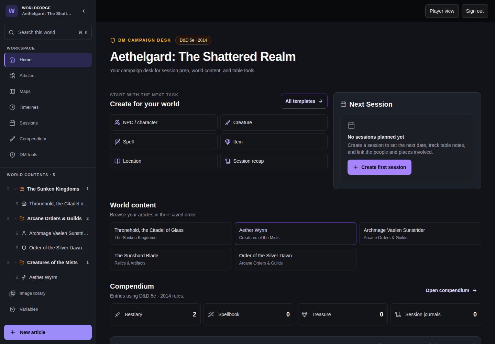
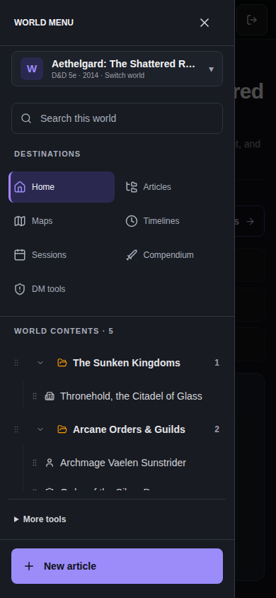

# WorldForge

WorldForge is a self-hosted campaign worldbuilding workspace for D&D 5e
(2014) and Pathfinder 2e Remaster. Authors create wiki-style worlds with
articles, maps, character sheets, timelines, images, and campaign tools, then
share only the material their readers should see.

Your content stays in a SQLite database and an image directory you control.

## Choose your path

- **I want to try WorldForge.** Follow [Getting Started](Getting-Started) to
  run the Docker stack, create an account and world, and publish an article.
- **I am installing a server.** Read [Installation](Installation), then review
  every supported setting in [Configuration](Configuration).
- **Something is not working.** Start with [Troubleshooting](Troubleshooting).

## A 60-second tour

1. Sign in and create a private, empty world with a rules profile.
2. Add categories and articles in the author workspace.
3. Write with the block editor and add structured game fields when useful.
4. Set an article to **Published** and **Public**, then make the world public.
5. Share the public reader URL. Private drafts, GM notes, and campaign secrets
   remain out of the public projection.

WorldForge also supports player accounts and invitations, audience policies,
interactive maps, D&D and Pathfinder character sheets, world export/import,
and full-installation backup and restore. Use the sidebar for task-oriented
feature guides, operations, and contributor references.

## See the workspace

The desktop campaign desk keeps creation shortcuts, world content, compendium
counts, and the article tree together:

### Desktop

On a narrow screen, the same destinations and article tree move into a compact
campaign navigation drawer:

### Mobile

Both screenshots use the optional Aethelgard demo seed. They contain no private
campaign or account data.

## Documentation status

The repository's `wiki/` directory is the canonical review source for these
guides; `docs/` retains implementation contracts and historical records. See
[Wiki Maintenance](Wiki-Maintenance) to propose an update and
[Wiki Verification](Wiki-Verification) for source versions, checks, and limits.
Each page records its own verification baseline; this is not a claim that every
workflow was rerun in a browser on every documentation edit.

**Source owner:** `wiki/Home.md` in the WorldForge repository.
**Verified against:** `v0.4.3` (`94c694c`), source/navigation audit. Existing
Aethelgard screenshots are retained from `eb117d5`; no new screenshots were taken.
